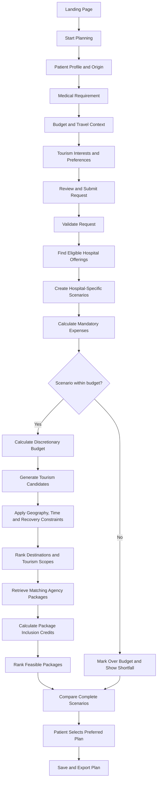
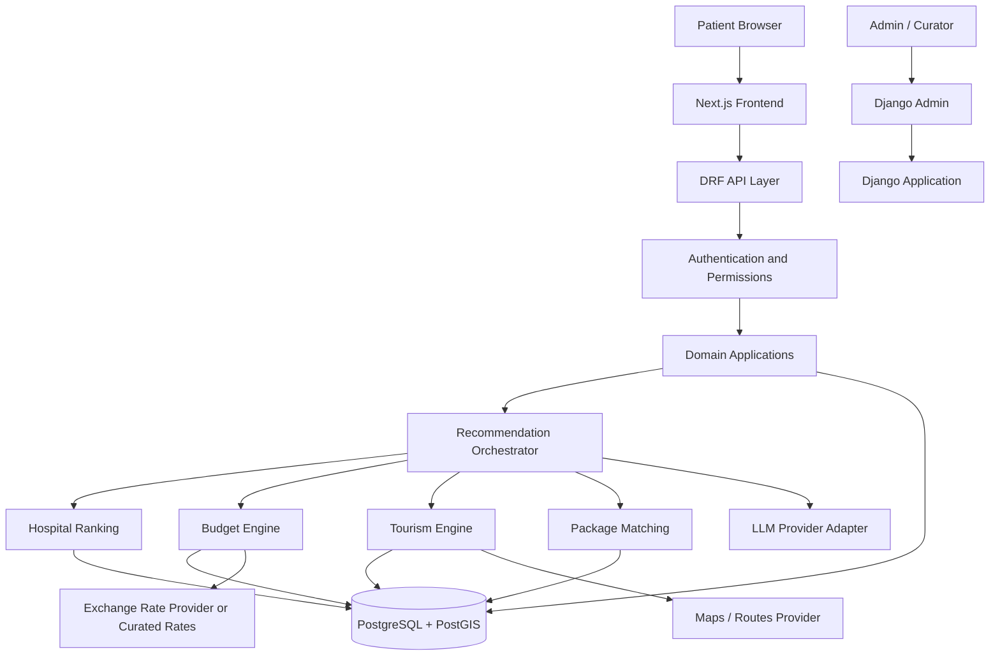

# TourPlus AI — Product Requirements & Technical Specification

> **Product:** TourPlus AI  
> **Description:** An AI-assisted, patient-centric decision-support platform for personalized medical tourism in India  
> **Document:** `PRODUCT.md`  
> **Version:** 1.0  
> **Status:** MVP implementation baseline  
> **Last updated:** 2 November 2026  
> **Audience:** Product, design, frontend, backend, AI/ML and QA contributors

---

## 1. Document purpose

This document is the implementation source of truth for the first working version of TourPlus AI. It defines the product, users, journeys, functional requirements, interface behavior, architecture, repository structure, database model, APIs, recommendation methods, financial mathematics, integrations, security, testing, release milestones and acceptance criteria.

UI development and backend development must proceed together. At every milestone, the visible interface should demonstrate the behavior that the backend supports. Screens must not be treated as static mockups disconnected from real application state.

When a requirement is not supported by validated data, the interface must label it as estimated, indicative or illustrative. Demonstration data must never be presented as verified real-world information.

### 1.1 Product principle

TourPlus AI is not simply a hospital directory, travel website or booking marketplace. It is a decision-support system that connects:

1. Medical-service discovery.
2. Hospital-specific financial planning.
3. Recovery-aware tourism recommendation.
4. Dynamic budget adjustment.
5. Travel-agency package matching.
6. A transparent, personalized medical-tourism plan.

### 1.2 Source-of-truth hierarchy

When product decisions conflict, use this order:

1. This `PRODUCT.md`.
2. Approved database schema and API contracts in the repository.
3. Approved design-system documentation and design files.
4. Existing implementation and tests.
5. Informal notes or comments.

Update this document when a scope or product decision changes. Do not silently change financial formulas, eligibility rules, API contracts or data meanings.

---

# 2. Product overview

## 2.1 Vision

Make planning an international medical journey to India more understandable and coordinated by connecting hospital discovery, financial feasibility, recovery constraints, tourism interests and travel packages through one explainable decision process.

## 2.2 Problem

International patients may have to research hospitals, treatment costs, international flights, visas, accommodation, local transportation, tourism destinations and agency packages through separate providers and websites.

The patient is then left to combine those pieces manually. This creates several problems:

- Hospital information and tourism information are disconnected.
- A treatment price does not represent the total cost of the medical journey.
- A patient may not know how much money remains after mandatory expenses.
- General tourism recommendations may not respect treatment location, recovery or travel-time constraints.
- Agency packages may include services already counted as separate mandatory expenses.
- Comparing a package by its headline price alone can be misleading.

## 2.3 Proposed solution

TourPlus AI asks the patient for their known medical requirement, budget, origin, travel context and preferences. It then creates a separate planning scenario for each eligible hospital.

For every hospital scenario, the platform:

1. Identifies hospitals with relevant, verified treatment offerings.
2. Estimates mandatory expenditure.
3. Calculates the initial discretionary tourism budget.
4. Recommends geographically and temporally feasible destinations.
5. Classifies recommendations into Local/Regional, State-Level and National/Pan-India scopes.
6. Finds curated agency packages that cover recommended destinations.
7. Adjusts budget accounting when packages include services already counted as mandatory.
8. Ranks feasible alternatives and explains the results.

The final result is a comparison of **hospital + budget + tourism + package**, not just a list of hospitals.

## 2.4 Target market

- **Primary:** international patients considering treatment in India.
- **Secondary:** family members or companions helping a patient plan.
- **Supply-side stakeholders:** hospitals, hotels and travel agencies.
- **Operational stakeholders:** TourPlus administrators and data curators.

## 2.5 Initial medical and geographic scope

**Initial treatment categories:**

- Cardiology
- Orthopedics
- Oncology

**Geographic coverage:**

- Major Indian hospital cities.
- Tourist destinations across India.
- Local/regional recommendations around each hospital city.
- State-level recommendations within the hospital's state.
- National/Pan-India recommendations where budget, duration and recovery constraints allow.

**Data approach:**

- Curated verified data where an authoritative or provider source is available.
- Indicative cost estimates when published prices are unavailable.
- Clearly labelled sample/demo records for development and demonstrations.
- Manually curated travel-agency packages during the initial release.

The initial catalogue targets are planning targets, not claims of current data availability:

| Dataset | Initial target |
|---|---:|
| Hospitals | 20–30 |
| Hospital cities | 8–12 |
| Specialty categories | 3 |
| Tourist destinations | 60–100 |
| Tourism interest categories | 8–12 |
| Travel agencies | 5–10 |
| Agency packages | 10–20 |

---

# 3. Product goals, non-goals and success criteria

## 3.1 MVP goals

1. Allow a patient to submit a structured medical-tourism request.
2. Return a transparent shortlist of hospitals matching the requested specialty/treatment offering.
3. Calculate a separate budget for every hospital scenario.
4. Recommend tourism destinations using preferences, geography, time and recovery constraints.
5. Support all three tourism scopes.
6. Match destinations against curated agency packages.
7. Apply dynamic budget adjustments for mandatory services included in a package.
8. Explain why hospitals, destinations and packages appear in the results.
9. Allow administrators/data curators to maintain the initial catalogue.
10. Preserve recommendation inputs, outputs and algorithm versions for reproducibility.

## 3.2 Non-goals for the initial MVP

The first release is not intended to:

- Diagnose a medical condition.
- Prescribe treatment or determine clinical suitability autonomously.
- Replace a treating doctor or hospital consultation.
- Provide a guaranteed treatment quote.
- Book or pay for flights, hotels, treatment or tours.
- Provide real-time airline inventory or live hotel reservation inventory.
- Process medical records or diagnostic images.
- Provide an automated visa approval decision.
- Claim that all Indian hospitals or all Indian tourist destinations are covered.
- Claim validated clinical outcomes or proven recommendation accuracy before formal testing.
- Allow unrestricted public agency self-registration.

## 3.3 Product success indicators

| Area | MVP success indicator |
|---|---|
| Patient intake | A patient can complete and save a valid planning request |
| Hospital discovery | Eligible hospitals are filtered by relevant specialty/treatment offering |
| Scenario planning | Every shortlisted hospital has its own budget scenario |
| Budget accuracy | Financial totals reconcile to their line items |
| Tourism | Recommendations obey configured geographical and time constraints |
| Package matching | Included mandatory services are credited without double-counting |
| Explainability | Each ranked result provides understandable reasons and data provenance |
| Data integrity | Verified, indicative and demo data are visibly distinguished |
| Security | Users can access only their own patient requests and plans |
| Admin operations | A curator can create, verify, expire and update catalogue records |

---

# 4. Users, roles and permissions

## 4.1 Patient

A patient can:

- Register and sign in.
- Maintain their profile and preferences.
- Create and edit their own planning requests.
- View hospital scenarios generated for their requests.
- View budget breakdowns.
- Explore tourism recommendations.
- Compare agency packages.
- Save a preferred plan.
- Export or print a plan summary.
- Delete or request deletion of their account and personal planning data, subject to the documented retention policy.

A patient cannot edit verified hospital credentials, published treatment offerings, source records or agency verification status.

## 4.2 Companion / family member

For the MVP, a companion may help the patient complete the request while using the patient account. A separate delegated-access feature is not required in the first release.

## 4.3 Administrator

An administrator can:

- Manage users and roles.
- Manage specialties and treatment categories.
- Manage hospitals, offerings and costs.
- Manage cities, states and tourist destinations.
- Manage agencies, packages and package inclusions.
- Verify, reject, expire and archive records.
- Review data-source metadata.
- Review recommendation runs and operational errors.
- Configure ranking weights and business rules through controlled settings.

## 4.4 Data curator

A data curator can manage catalogue content but cannot change security settings, administrator roles or sensitive system configuration.

## 4.5 Agency role — later phase

Agency self-registration and a self-service agency portal are not part of the initial MVP. The schema should be ready to associate agency users with an agency later.

## 4.6 Permission principles

- Enforce permissions on the backend, not only in the UI.
- A patient can read and modify only their own requests and plans.
- Curators can edit only assigned catalogue domains.
- Only administrators can change verification status and system ranking configuration.
- Sensitive fields must not be exposed in public hospital, destination or package APIs.

---

# 5. Core product principles

1. **Medical safety first:** medical relevance and clinician-provided constraints are not overridden by tourism preference or price.
2. **Scenario-specific planning:** each hospital is evaluated with its own treatment, travel, accommodation and tourism context.
3. **Financial transparency:** every total can be traced to individual cost lines, currency and source.
4. **No double-counting:** package inclusions can credit only the mandatory expense they genuinely replace.
5. **Explainable ranking:** show the factors responsible for a recommendation.
6. **Data provenance:** keep source, verification status and last-checked timestamp.
7. **Human decision-making:** recommendations support patients and clinicians; they do not replace them.
8. **Progressive complexity:** start with a curated catalogue and a modular monolith; add integrations only when needed.
9. **UI and backend together:** each product milestone should produce a working, testable user journey.
10. **No fabricated certainty:** distinguish verified facts from indicative estimates and sample data.

---

# 6. End-to-end user journey

## 6.1 Journey overview



## 6.2 Hospital-specific scenarios are mandatory

Do not calculate one generic budget for the patient and reuse it for every hospital.

For a patient comparing hospitals in Delhi, Mumbai and Chennai, each hospital may have a different treatment estimate, flight cost, accommodation cost and nearby tourism opportunities. Each must therefore have its own:

- Treatment estimate.
- International flight estimate.
- Accommodation estimate.
- Visa and miscellaneous expenses.
- Discretionary tourism budget.
- Destination ranking.
- Agency package matches.

The same patient request may produce multiple hospital scenarios, each with different feasible tourism options.

## 6.3 Request lifecycle

Recommended statuses:

- `DRAFT`
- `SUBMITTED`
- `PROCESSING`
- `COMPLETED`
- `COMPLETED_WITH_WARNINGS`
- `FAILED`
- `ARCHIVED`

A recommendation run is a separate record from the trip request. A patient can regenerate recommendations after changing inputs, and the prior run remains auditable.

---

# 7. Functional requirements

## 7.1 Landing page

**Purpose:** Explain TourPlus and let a visitor begin the planning process.

Required elements:

- Brand and primary navigation.
- Hero statement and primary “Start Planning” action.
- How-it-works section.
- Healthcare, budget, tourism and package-matching explanation.
- Safety/disclaimer note.
- Footer with About, Privacy, Terms and Contact placeholders.

Acceptance criteria:

- The primary action opens the patient planning flow.
- The page is responsive.
- No fabricated endorsements, partner logos, hospital affiliations or performance claims are displayed.

## 7.2 Authentication and profile

- Patient registration and login.
- Email validation.
- Password reset.
- Logout.
- Patient profile editing.
- Country, preferred language and display currency.
- Consent capture for data processing.

Acceptance criteria:

- Passwords are never stored in plain text.
- Authenticated endpoints enforce ownership.
- The frontend handles expired sessions cleanly.

## 7.3 Patient assessment wizard

Use a multi-step form with autosave/draft behavior where practical.

### Step 1 — Personal and travel origin

- Origin country.
- Preferred language.
- Display currency.
- Number of travellers.
- Preferred arrival window or tentative dates.

### Step 2 — Medical requirement

- Specialty: Cardiology, Orthopedics or Oncology.
- Known condition or treatment requirement.
- Treatment category, where known.
- Optional preferred hospital city.
- Referral/doctor-provided information as text only in MVP.

The LLM may help map free-text input to predefined categories. The mapping must be shown for patient confirmation. It must not diagnose or infer a disease from symptoms.

### Step 3 — Recovery and travel constraints

- Expected recovery duration, if known.
- Available travel window.
- Clinician-provided travel restrictions.
- Mobility or travel-intensity constraints.
- Whether the patient has clinician guidance about post-treatment travel.

If clinical travel guidance is unavailable, recommendations must be marked as requiring clinician confirmation. The system must not claim that a destination or activity is medically safe.

### Step 4 — Financial information

- Total available budget.
- Currency.
- Insurance status and relevant coverage notes.
- Cost flexibility or contingency preference.
- Whether the budget is for the patient alone or the complete travel group.

### Step 5 — Tourism preferences

- Historical/heritage.
- Nature/wildlife.
- Culture.
- Museums.
- Beaches.
- Spiritual/heritage sites, where selected by the user.
- Modern attractions.
- Food experiences.
- Nightlife, where appropriate.
- Preferred travel intensity.
- Preferred accommodation level.

### Step 6 — Review

Show a complete summary and allow editing before submission.

Acceptance criteria:

- Required fields are validated.
- Currency is explicit.
- Party size is explicit.
- Consent is recorded.
- The application never silently assumes missing recovery restrictions or medical facts.
- The user can save a draft and return later.

## 7.4 Hospital discovery and recommendation

Required behavior:

1. Filter hospitals by relevant specialty.
2. Filter by treatment offering when a specific treatment category has been selected.
3. Exclude inactive or unverified records according to publication rules.
4. Show the data completeness and verification status.
5. Rank remaining candidates using transparent, configurable criteria.
6. Create a separate scenario for every eligible hospital.
7. Show why each hospital was included or excluded.

Hospital result card:

- Hospital name.
- City and state.
- Relevant specialty and treatment offering.
- Available published treatment-cost range.
- International-patient services, if verified.
- Accreditation/credential information, if verified.
- Source and last-updated date.
- “View scenario” action.

Never label the highest-scoring hospital as “medically best.” Use phrases such as “matched hospital,” “eligible offering” or “recommended for further consultation.”

## 7.5 Hospital scenario and budget dashboard

For every hospital scenario, show:

- Treatment estimate.
- International flight estimate.
- Accommodation estimate.
- Visa estimate.
- Local transport estimate.
- Miscellaneous estimate.
- Total mandatory expenditure.
- Initial discretionary tourism budget.
- Over-budget shortfall, if applicable.
- Sources, estimate ranges and confidence/verification labels.

Allow the patient to compare scenarios side-by-side.

## 7.6 Tourism recommendation

Generate destination options for every financially and temporally feasible hospital scenario.

Each destination card should show:

- Destination name.
- City and state.
- Tourism categories.
- Approximate distance from the hospital city.
- Estimated travel time, when a route provider supplies it.
- Indicative visit cost.
- Suggested visit duration.
- Travel intensity/accessibility notes where verified.
- Preference-match explanation.
- Data and price verification status.

The platform supports three hierarchical scopes:

1. **Local / Regional:** treatment city and nearby destinations.
2. **State-Level:** selected destinations in the same state.
3. **National / Pan-India:** selected destinations across India.

A wider scope is not automatically better. It is recommended only when budget, time, geographical feasibility and clinician-provided restrictions permit it.

## 7.7 Dynamic package matching

This is a signature MVP feature.

1. Take the destination recommendation set.
2. Retrieve active packages from verified or approved agencies.
3. Filter by date validity, party size and package availability.
4. Compare package destinations against recommended destinations.
5. Parse package inclusions and exclusions.
6. Identify services that replace originally budgeted mandatory expenses.
7. Calculate inclusion credits with caps and quantity/date overlap checks.
8. Calculate effective incremental cost.
9. Exclude financially infeasible packages.
10. Rank remaining packages by coverage, cost efficiency, itinerary fit and agency reliability.
11. Explain the ranking.

Package card:

- Agency and verification status.
- Package name.
- Listed price and price basis.
- Duration.
- Destination coverage.
- Included services.
- Excluded/optional services.
- Mandatory expense credit applied.
- Effective incremental cost.
- Remaining budget.
- Last verified date.
- “Compare” / “Select” action.

## 7.8 Growth strategy and agency catalogue

### Phase I — curated

Administrators add and verify packages from selected agencies.

### Phase II — agency onboarding

Later, agencies may:

- Apply for an account.
- Submit organization details.
- Complete verification.
- Create and edit packages.
- Provide prices, destinations, inclusions and validity.
- Submit packages for approval.
- See approval/rejection status.

Agency self-service is a later extension. The initial database should be designed to support it, but the first release uses admin-curated records.

## 7.9 Final plan

A final plan combines:

- Selected hospital scenario.
- Treatment estimate and mandatory expenses.
- Discretionary budget.
- Selected tourism scope.
- Ordered destinations.
- Matched agency package, if selected.
- Effective package cost and remaining budget.
- Data caveats and verification dates.
- Medical-safety disclaimer.

The user can save the plan and print/export a summary. PDF export is a planned MVP enhancement after the HTML plan view is stable.

## 7.10 Administration and data curation

Django Admin is the initial operations interface.

Admin capabilities:

- Create/update/archive hospitals.
- Add specialty and treatment offerings.
- Maintain indicative cost estimates.
- Manage states and cities.
- Add destinations and tourism categories.
- Add source records.
- Create travel agencies.
- Create packages and package destinations.
- Add package inclusions and exclusions.
- Verify and expire records.
- Review failed recommendation runs.

The admin UI must validate important fields and prevent publishing incomplete records.

## 7.11 Recommendation history

- Store each recommendation run.
- Store a snapshot of the submitted inputs.
- Store algorithm/configuration version.
- Store ranked candidates and exclusion reasons.
- Store data record versions or timestamps used in the run.
- Allow a patient to view prior runs.

## 7.12 Notifications

MVP: in-app status feedback and email verification/password reset where configured.

Later: agency response notifications, appointment reminders, itinerary updates and travel disruption alerts.

---

# 8. User interface and experience specification

UI work must proceed at the same time as backend work. Build the real application shell and design system first, then connect each screen as the corresponding API becomes available.

## 8.1 Visual direction

**Theme:** Clinical Blue × India Green.

The interface should feel like a modern healthcare decision-support product: trustworthy, calm, clear, accessible and professional. It should not look like a generic travel booking site or a dark futuristic AI dashboard.

### Color tokens

| Token | Value | Use |
|---|---|---|
| `--color-primary` | `#103044` | Main headings, primary text |
| `--color-blue` | `#1B74A8` | Medical and navigation accents |
| `--color-green` | `#259970` | Success, optimization, selected states |
| `--color-cyan` | `#2DA6C9` | Secondary highlights |
| `--color-bg` | `#FFFFFF` | Main page background |
| `--color-surface` | `#F4F7F9` | Alternate sections/cards |
| `--color-mint` | `#E4F6EF` | Green-tinted panels |
| `--color-light-blue` | `#E6F4FA` | Blue-tinted panels |
| `--color-text` | `#233038` | Body text |
| `--color-muted` | `#697781` | Secondary text |
| `--color-border` | `#D6E1E8` | Dividers and borders |
| `--color-danger` | `#B94A48` | Errors and infeasible states |
| `--color-warning` | `#A66B16` | Missing/uncertain data |

### Typography

- Headings: Montserrat or a similar geometric sans serif.
- Body: Inter, Poppins or system sans serif.
- Body text should remain highly readable.
- Use a consistent typographic scale.
- Avoid tiny grey labels for important cost or safety information.

### Component style

- White cards with subtle borders.
- 12–18 px corner radius.
- Small and restrained shadows.
- Clear section spacing.
- Consistent icon family (Lucide or equivalent).
- No emoji icons in the production UI.
- Avoid excessive gradients and glassmorphism.
- Use green to highlight meaningful status or a key innovation, not every button.

## 8.2 Layout principles

- Desktop-first for the admin and comparison dashboards, but fully responsive.
- Patient assessment must work well on mobile.
- Use a centered content container with consistent max width.
- Use persistent step progress on the assessment wizard.
- Use comparison tables only when data is genuinely tabular.
- Keep primary actions visible and secondary actions visually quieter.
- Display loading, empty, error, warning and success states for all data-dependent sections.
- Never show blank cards while the backend is loading.

## 8.3 Main pages and routes

| Route | Page | Access |
|---|---|---|
| `/` | Landing page | Public |
| `/how-it-works` | Product explanation | Public |
| `/about` | About TourPlus | Public |
| `/login` | Login | Public |
| `/register` | Registration | Public |
| `/forgot-password` | Password reset | Public |
| `/dashboard` | Patient dashboard | Patient |
| `/profile` | Patient profile/preferences | Patient |
| `/plan/new` | Assessment wizard | Patient |
| `/plan/[requestId]/review` | Request review | Patient |
| `/plan/[requestId]/processing` | Recommendation status | Patient |
| `/plan/[requestId]/results` | Hospital scenario comparison | Patient |
| `/scenario/[scenarioId]` | Scenario overview | Patient |
| `/scenario/[scenarioId]/budget` | Cost breakdown | Patient |
| `/scenario/[scenarioId]/destinations` | Tourism recommendations | Patient |
| `/scenario/[scenarioId]/packages` | Package matches | Patient |
| `/final-plan/[planId]` | Saved final plan | Patient |
| `/admin` | Admin entry/operations link | Admin/Curator |

The initial release can use Django Admin for catalogue operations rather than building a separate custom admin frontend. The route `/admin` may link to the secured Django admin.

## 8.4 Landing page sections

1. Navigation and brand.
2. Hero: “Plan your medical journey to India with greater clarity.”
3. Primary call to action: “Start Planning.”
4. Four-part explanation: Hospital, Budget, Tourism, Package.
5. How it works.
6. Why integrated planning matters.
7. Medical safety and data transparency note.
8. Footer.

Do not use unsupported statements such as “India's number one platform” or unverifiable patient success claims.

## 8.5 Dashboard

Dashboard content:

- Welcome message.
- Start a new plan.
- Draft requests.
- Completed recommendation runs.
- Saved final plans.
- Recent activity.
- Profile completion reminder.

## 8.6 Assessment wizard UX

- Display step name, progress and estimated completion time.
- Save a draft between steps.
- Validate at field level.
- Provide “Back” and “Continue.”
- Use accessible selects and multi-select chips.
- Display currency beside every financial field.
- Explain why recovery information is requested.
- Provide a visible disclaimer that TourPlus does not diagnose or certify fitness to travel.
- Show final summary before submission.

## 8.7 Hospital comparison UX

Desktop: comparison table or aligned cards. Mobile: stacked cards.

Important visual hierarchy:

1. Hospital name and location.
2. Specialty/treatment match.
3. Indicative treatment cost range.
4. Verification status.
5. Scenario total/financial feasibility.
6. “View complete scenario.”

Do not rank by price alone.

## 8.8 Budget dashboard UX

Show:

- Total patient budget.
- Mandatory expenditure.
- Initial discretionary tourism budget.
- Over-budget shortfall or feasible status.

Use a stacked bar only if its values are accurate and its segments sum to the displayed total.

Package selection should visibly show:

- Initial discretionary budget.
- Included service credit.
- Effective incremental package cost.
- Remaining discretionary budget.

## 8.9 Tourism UX

Provide scope tabs or segmented controls:

- Local / Regional
- State-Level
- National / Pan-India

Each scope shows only feasible destination options and explains why a destination appears.

Use maps only when coordinates and route data are available. Do not invent travel times.

## 8.10 Package comparison UX

Provide side-by-side package comparison with:

- Listed package price.
- Destinations covered.
- Included and excluded services.
- Inclusion credit.
- Effective incremental cost.
- Remaining budget.
- Agency/data verification status.

Visually distinguish listed price from effective cost; they are not interchangeable.

## 8.11 Accessibility and responsive requirements

- Semantic headings and form labels.
- Keyboard operability.
- Visible focus states.
- Sufficient contrast.
- Text alternatives for informative images/icons.
- Do not communicate status by color alone.
- Responsive layouts for small mobile screens, tablets and desktops.
- Tables should have a mobile-friendly alternative.

---

# 9. Technical architecture

## 9.1 Technology decisions

| Layer | Technology | Responsibility |
|---|---|---|
| Frontend | Next.js App Router | Web pages and navigation |
| UI | React + TypeScript | Components and client interactions |
| Styling | Tailwind CSS | Design tokens and responsive styling |
| Backend | Django 5.2 LTS | Core application and domain logic |
| API | Django REST Framework | REST endpoints and serializers |
| Database | PostgreSQL (Supabase-hosted) | Persistent relational data |
| Geospatial | PostGIS | Coordinate and distance queries |
| Authentication | Django authentication + secure API session/token strategy | User identity and access |
| AI | Provider-abstracted LLM API | Structured extraction and explanations |
| Recommendation | Python services | Filtering, scoring and optimization |
| Maps | Google Maps Routes API or approved provider | Route distance/time |
| Deployment | Vercel + Python application host + Supabase | Hosting |

Use a modular monolith for the MVP. Do not introduce microservices, FastAPI or Flask at the beginning. A separate AI service can be introduced later if there is a demonstrated operational need.

## 9.2 High-level architecture



The LLM and external providers are optional dependencies. Core budget and eligibility logic must continue to work without an LLM.

## 9.3 Backend architecture pattern

Use domain-oriented Django apps and service modules:

- Models define persistent entities and relationships.
- Serializers validate API inputs and outputs.
- Views/ViewSets handle HTTP and permissions.
- Services contain application workflows.
- Engine modules contain ranking and mathematical logic.
- Provider adapters isolate third-party services.
- Tests cover services and API contracts.

Do not place complex scoring or financial calculations inside serializers, model properties or large API views.

## 9.4 Frontend-to-backend integration

The frontend must call versioned API endpoints through a centralized API client.

Requirements:

- One API base URL from environment configuration.
- Typed request and response interfaces.
- Centralized error handling.
- Consistent loading and empty states.
- Authenticated requests handled through a secure cookie/token strategy.
- Never place a secret API key in browser code.
- Do not call the database directly from browser components.
- Do not hardcode recommendation data in production page components.

The frontend may use mock data during early UI development, but mock responses must be isolated in a development-only mock layer and replaced by real API calls before a feature is marked complete.

---

# 10. Repository structure

Use a single repository for the MVP to keep development, UI integration and deployment coordinated.

```text
tourplus-ai/
│
├── PRODUCT.md
├── README.md
├── CHANGELOG.md
├── .gitignore
├── .editorconfig
├── .env.example
├── docker-compose.yml
│
├── docs/
│   ├── architecture.md
│   ├── database-schema.md
│   ├── api-contracts.md
│   ├── recommendation-methodology.md
│   ├── financial-model.md
│   ├── security-and-privacy.md
│   ├── data-curation-guide.md
│   └── decisions/
│       ├── ADR-001-modular-monolith.md
│       ├── ADR-002-budget-ledger.md
│       └── ADR-003-recommendation-method.md
│
├── frontend/
│   ├── package.json
│   ├── next.config.ts
│   ├── tsconfig.json
│   ├── tailwind.config.ts
│   ├── public/
│   │   ├── images/
│   │   ├── icons/
│   │   └── logo/
│   │
│   └── src/
│       ├── app/
│       │   ├── (public)/
│       │   │   ├── page.tsx
│       │   │   ├── how-it-works/
│       │   │   └── about/
│       │   ├── (auth)/
│       │   │   ├── login/
│       │   │   ├── register/
│       │   │   └── forgot-password/
│       │   ├── (patient)/
│       │   │   ├── dashboard/
│       │   │   ├── profile/
│       │   │   ├── plan/
│       │   │   │   ├── new/
│       │   │   │   └── [requestId]/
│       │   │   │       ├── review/
│       │   │   │       ├── processing/
│       │   │   │       └── results/
│       │   │   ├── scenario/
│       │   │   │   └── [scenarioId]/
│       │   │   │       ├── page.tsx
│       │   │   │       ├── budget/
│       │   │   │       ├── destinations/
│       │   │   │       └── packages/
│       │   │   └── final-plan/
│       │   │       └── [planId]/
│       │   ├── api/
│       │   ├── layout.tsx
│       │   ├── globals.css
│       │   └── not-found.tsx
│       │
│       ├── components/
│       │   ├── ui/
│       │   ├── layout/
│       │   ├── forms/
│       │   ├── data-display/
│       │   ├── charts/
│       │   ├── maps/
│       │   └── feedback/
│       │
│       ├── features/
│       │   ├── auth/
│       │   ├── patient-profile/
│       │   ├── trip-assessment/
│       │   ├── hospital-results/
│       │   ├── budget/
│       │   ├── tourism/
│       │   ├── packages/
│       │   └── final-plan/
│       │
│       ├── lib/
│       │   ├── api-client.ts
│       │   ├── auth.ts
│       │   ├── currency.ts
│       │   ├── formatters.ts
│       │   └── validation.ts
│       │
│       ├── hooks/
│       ├── types/
│       ├── config/
│       └── tests/
│
├── backend/
│   ├── manage.py
│   ├── pyproject.toml
│   ├── requirements/
│   │   ├── base.txt
│   │   ├── dev.txt
│   │   └── prod.txt
│   │
│   ├── config/
│   │   ├── __init__.py
│   │   ├── settings/
│   │   │   ├── base.py
│   │   │   ├── development.py
│   │   │   └── production.py
│   │   ├── urls.py
│   │   ├── asgi.py
│   │   └── wsgi.py
│   │
│   ├── apps/
│   │   ├── accounts/
│   │   ├── geography/
│   │   ├── medical/
│   │   ├── hospitals/
│   │   ├── tourism/
│   │   ├── finance/
│   │   ├── agencies/
│   │   ├── packages/
│   │   ├── trip_planning/
│   │   ├── recommendations/
│   │   └── audit/
│   │
│   ├── engines/
│   │   ├── hospitals/
│   │   ├── budgeting/
│   │   ├── tourism/
│   │   └── package_matching/
│   │
│   ├── integrations/
│   │   ├── llm/
│   │   ├── maps/
│   │   └── exchange_rates/
│   │
│   ├── common/
│   │   ├── permissions/
│   │   ├── validators/
│   │   ├── exceptions/
│   │   ├── pagination/
│   │   └── utils/
│   │
│   ├── seed/
│   │   ├── fixtures/
│   │   └── importers/
│   │
│   └── tests/
│       ├── unit/
│       ├── integration/
│       └── api/
│
├── scripts/
│   ├── bootstrap.sh
│   ├── seed_demo_data.py
│   ├── import_hospitals.py
│   ├── import_destinations.py
│   └── validate_catalogue.py
│
└── .github/
    └── workflows/
        ├── frontend-ci.yml
        └── backend-ci.yml
```

### Repository rules

- Keep business logic in `backend/engines/` or domain services.
- Keep API-specific logic in Django views/serializers.
- Keep reusable UI primitives in `frontend/src/components/ui/`.
- Keep feature-specific UI inside `frontend/src/features/`.
- Keep all external integrations behind provider adapters.
- Do not commit `.env` files, access tokens, credentials or patient data.
- Add tests whenever a formula, permission rule or ranking rule changes.
- Keep database migrations in version control.

---

# 11. Database design

## 11.1 Database principles

- Use PostgreSQL as the system of record.
- Use UUID primary keys for primary business entities.
- Use foreign keys for relationships.
- Use `DecimalField`/fixed-precision decimal values for money; never use floating-point values for financial totals.
- Store the currency code with every monetary amount.
- Store timestamps in UTC.
- Store source and verification metadata for material claims and estimates.
- Use soft archive/status fields for reference data where appropriate.
- Use PostGIS geography or geometry fields for coordinates and spatial queries.
- Keep historical recommendation outputs rather than overwriting them on every new run.

## 11.2 Common audit fields

Most mutable catalogue tables should include:

```text
id                  UUID primary key
created_at          timestamp with timezone
updated_at          timestamp with timezone
created_by_id       nullable user foreign key
updated_by_id       nullable user foreign key
status              active / inactive / archived, as appropriate
```

Do not add these fields mechanically to immutable junction tables if they are not useful.

## 11.3 Accounts domain

### `users`

| Field | Type | Notes |
|---|---|---|
| id | UUID | Primary key |
| email | varchar, unique | Login identifier |
| password | Django password hash | Never store plain text |
| role | enum | PATIENT / ADMIN / DATA_CURATOR |
| is_active | boolean | Account state |
| email_verified_at | timestamp, nullable | Verification |
| created_at | timestamp | UTC |

Use a custom Django User model from the beginning.

### `patient_profiles`

| Field | Type | Notes |
|---|---|---|
| id | UUID | Primary key |
| user_id | FK users | One-to-one |
| full_name | varchar | Optional display name |
| origin_country_id | FK countries | Patient origin |
| preferred_language | varchar | Locale code |
| display_currency | char(3) | ISO currency |
| phone_country_code | varchar, nullable | Optional |
| phone_number | encrypted/nullable | Only if required |
| created_at / updated_at | timestamps | Audit |

### `consent_records`

- `id`
- `user_id`
- `consent_type`
- `policy_version`
- `accepted_at`
- `withdrawn_at`
- `source`

Capture consent explicitly for account data, personal data and optional AI processing where applicable.

## 11.4 Geography domain

### `countries`

- `id`
- `name`
- `iso2`
- `iso3`
- `default_currency`
- `is_active`

### `states`

- `id`
- `country_id`
- `name`
- `code`

### `cities`

- `id`
- `state_id`
- `name`
- `latitude`
- `longitude`
- `location` (PostGIS point, optional but recommended)
- `is_active`

Use unique constraints appropriate to the parent region, e.g. city name + state.

## 11.5 Medical domain

### `specialties`

- `id`
- `name`
- `slug`
- `description`
- `is_active`

Initial seed values: Cardiology, Orthopedics, Oncology.

### `treatment_categories`

- `id`
- `specialty_id`
- `name`
- `slug`
- `description`
- `is_active`
- `review_status`

Treatment categories must be curated from reliable terminology and verified hospital offerings. Do not infer a treatment catalogue from an LLM.

### `hospitals`

- `id`
- `name`
- `slug`
- `description`
- `city_id`
- `address`
- `postal_code`
- `latitude`
- `longitude`
- `location` (PostGIS point)
- `website_url`
- `international_patient_support`
- `international_patient_details`
- `verification_status`
- `data_classification`
- `source_id`
- `last_verified_at`
- `is_published`

### `hospital_specialties`

- `id`
- `hospital_id`
- `specialty_id`
- `verification_status`
- `source_id`

Unique constraint: `(hospital_id, specialty_id)`.

### `hospital_treatment_offerings`

- `id`
- `hospital_id`
- `treatment_category_id`
- `offering_description`
- `availability_status`
- `verification_status`
- `source_id`
- `last_verified_at`

### `treatment_cost_estimates`

- `id`
- `hospital_treatment_offering_id`
- `min_amount`
- `expected_amount`
- `max_amount`
- `currency`
- `price_basis` (per treatment / per session / package / unknown)
- `included_services`
- `excluded_services`
- `valid_from`
- `valid_until`
- `source_id`
- `data_classification`
- `last_verified_at`

Validation:

- `min_amount <= expected_amount <= max_amount`.
- Amounts must be non-negative.
- Currency must be a valid supported ISO currency code.
- A cost estimate without a reliable source must be marked `INDICATIVE` or `DEMO`.

## 11.6 Tourism domain

### `destination_categories`

Seed examples:

- Heritage and History
- Nature
- Wildlife
- Culture
- Museums
- Beaches
- Spiritual and Heritage Sites
- Modern Attractions
- Food Experiences
- Nightlife

### `tourist_destinations`

- `id`
- `name`
- `slug`
- `description`
- `city_id`
- `latitude`
- `longitude`
- `location` (PostGIS point)
- `suggested_visit_duration_minutes`
- `travel_intensity` (LOW / MODERATE / HIGH / UNKNOWN)
- `accessibility_notes`
- `opening_information`
- `entry_fee_min`
- `entry_fee_expected`
- `entry_fee_max`
- `currency`
- `verification_status`
- `data_classification`
- `source_id`
- `last_verified_at`
- `is_published`

### `destination_category_links`

- `id`
- `destination_id`
- `category_id`

Unique constraint: `(destination_id, category_id)`.

### `destination_cost_estimates`

- `id`
- `destination_id`
- `cost_type`
- `min_amount`
- `expected_amount`
- `max_amount`
- `currency`
- `party_basis`
- `valid_from`
- `valid_until`
- `source_id`
- `data_classification`

Cost types may include entry, local activity, local transport, food estimate and other visitor costs. Avoid mixing different cost types into a single opaque estimate.

## 11.7 Agency and package domain

### `travel_agencies`

- `id`
- `name`
- `slug`
- `website_url`
- `contact_email`
- `contact_phone`
- `headquarters_city_id`
- `verification_status`
- `data_classification`
- `source_id`
- `last_verified_at`
- `is_published`

### `travel_packages`

- `id`
- `agency_id`
- `name`
- `description`
- `package_type` (LOCAL / STATE / NATIONAL / CUSTOM)
- `duration_days`
- `price_amount`
- `currency`
- `price_basis` (PER_PERSON / PER_GROUP / OTHER)
- `minimum_group_size`
- `maximum_group_size`
- `valid_from`
- `valid_until`
- `departure_rules`
- `cancellation_terms`
- `availability_status`
- `verification_status`
- `data_classification`
- `source_id`
- `last_verified_at`
- `is_published`

### `package_destinations`

- `id`
- `package_id`
- `destination_id`
- `sequence_order`
- `planned_visit_duration`
- `overnight_stay`

This records the actual destinations covered and their sequence.

### `package_inclusions`

- `id`
- `package_id`
- `inclusion_type`
- `inclusion_status` (INCLUDED / OPTIONAL_EXTRA / NOT_INCLUDED)
- `description`
- `quantity`
- `unit`
- `service_value_amount`
- `service_value_currency`
- `service_start_date`
- `service_end_date`
- `party_basis`
- `equivalent_budget_category`
- `source_id`
- `verification_status`

The `equivalent_budget_category` connects an included service to a mandatory cost line that it may replace, e.g. `INTERNATIONAL_FLIGHT`, `ACCOMMODATION` or `LOCAL_TRANSPORT`.

A value can receive a budget credit only when its coverage, quantity, party basis and time period are comparable with the cost line it replaces.

## 11.8 Data provenance and currency

### `data_sources`

- `id`
- `source_name`
- `publisher`
- `source_url`
- `source_type`
- `accessed_at`
- `notes`
- `reliability_level`

### `exchange_rates`

- `id`
- `base_currency`
- `quote_currency`
- `rate`
- `effective_at`
- `provider_name`
- `source_url`

Store the rate used for each recommendation run. Do not silently recalculate old recommendation results using a new exchange rate.

### Data classification enum

- `VERIFIED`: checked against an authoritative or provider source.
- `INDICATIVE`: reasonable estimate, not a confirmed quote.
- `DEMO`: illustrative test data.
- `EXPIRED`: old or no longer valid.
- `REJECTED`: reviewed and not approved for display.

Production recommendation queries should exclude `DEMO`, `EXPIRED` and `REJECTED` records unless an explicit development/demo mode is enabled.

## 11.9 Trip planning domain

### `trip_requests`

- `id`
- `user_id`
- `origin_country_id`
- `specialty_id`
- `treatment_category_id`, nullable until confirmed
- `known_condition_text`
- `total_budget_amount`
- `budget_currency`
- `party_size`
- `preferred_arrival_date`, nullable
- `preferred_departure_date`, nullable
- `available_days`
- `recovery_duration_days`, nullable
- `clinician_travel_guidance_status`
- `clinician_restrictions`
- `insurance_status`
- `travel_intensity_preference`
- `status`
- `submitted_at`

Keep the medical information collected to the minimum necessary for the recommendation.

### `trip_request_interests`

- `id`
- `trip_request_id`
- `destination_category_id`
- `preference_weight`

A patient can select multiple interests and optionally prioritize them.

### `recommendation_runs`

- `id`
- `trip_request_id`
- `run_number`
- `status`
- `algorithm_version`
- `weight_configuration_snapshot`
- `input_snapshot`
- `started_at`
- `completed_at`
- `error_code`
- `error_message`

The input and configuration snapshots make results reproducible.

### `hospital_scenarios`

- `id`
- `recommendation_run_id`
- `hospital_treatment_offering_id`
- `rank`
- `eligibility_status`
- `exclusion_reason`
- `ranking_score`
- `scenario_currency`
- `scenario_notes`

A scenario represents one eligible hospital/treatment offering for a specific recommendation run.

### `scenario_budget_lines`

- `id`
- `hospital_scenario_id`
- `expense_category`
- `description`
- `min_amount`
- `expected_amount`
- `max_amount`
- `source_currency`
- `scenario_currency`
- `exchange_rate_snapshot`
- `converted_expected_amount`
- `quantity`
- `unit`
- `validity_date`
- `source_id`
- `data_classification`

Each scenario line should retain its original currency and its converted amount.

### `destination_recommendations`

- `id`
- `hospital_scenario_id`
- `destination_id`
- `tourism_scope`
- `rank`
- `interest_score`
- `geography_score`
- `cost_score`
- `data_confidence_score`
- `recovery_review_status`
- `estimated_visit_cost`
- `estimated_route_cost`
- `estimated_route_duration`
- `feasibility_status`
- `explanation`

### `package_matches`

- `id`
- `hospital_scenario_id`
- `travel_package_id`
- `rank`
- `destination_coverage_score`
- `inclusion_credit`
- `listed_package_price`
- `effective_incremental_cost`
- `remaining_discretionary_budget`
- `budget_feasibility_status`
- `itinerary_fit_score`
- `agency_reliability_score`
- `overall_score`
- `explanation`

### `package_match_inclusion_credits`

- `id`
- `package_match_id`
- `package_inclusion_id`
- `scenario_budget_line_id`
- `credited_amount`
- `credited_currency`
- `credit_reason`

This junction table is essential for auditability. It records exactly which inclusion credited which original expense.

### `final_plans`

- `id`
- `user_id`
- `hospital_scenario_id`
- `package_match_id`, nullable
- `selected_scope`
- `status`
- `plan_title`
- `created_at`
- `updated_at`

### `final_plan_destinations`

- `id`
- `final_plan_id`
- `destination_id`
- `sequence_order`
- `planned_visit_date`, nullable
- `planned_duration_minutes`
- `notes`

## 11.10 Audit and system configuration

### `audit_events`

Track important administrative actions:

- Who changed a record.
- What record changed.
- Field changes where practical.
- Timestamp.
- Reason or review note.

### `recommendation_configurations`

Store versioned ranking weights, thresholds and feature flags. Do not bury important product weights as scattered constants in code.

---

# 12. Financial model and exact calculation rules

This section is authoritative for MVP financial logic.

## 12.1 Currency rules

- Every monetary amount has a currency code.
- A recommendation run chooses one scenario currency, normally the patient's selected display/planning currency.
- Convert each line using a recorded exchange-rate snapshot.
- Store original and converted values.
- Use decimal arithmetic, never binary float arithmetic.
- Show “estimate” whenever the source is not a confirmed quote.
- Do not compare two amounts until they are converted to the same currency and price basis.

Let `FX(c → s)` represent the recorded conversion rate from source currency `c` to scenario currency `s`.

\[
Amount_s = Amount_c \times FX(c \rightarrow s)
\]

## 12.2 Mandatory expenditure

For hospital scenario \(s\):

\[
ME_s = TC_s + FC_s + HC_s + VC_s + LC_s + MC_s
\]

Where:

- \(TC_s\): treatment cost.
- \(FC_s\): international flight cost.
- \(HC_s\): baseline accommodation cost for the medical stay.
- \(VC_s\): visa-related cost.
- \(LC_s\): local transport and transfers.
- \(MC_s\): other mandatory/miscellaneous costs.

All line items must be expressed in the scenario currency before summation.

Accommodation should use quantity-based calculations where possible:

\[
HC_s = NightlyRate \times Nights \times Rooms
\]

Treatment and flight costs may be ranges.

## 12.3 Initial discretionary budget

\[
DB_{0,s} = B_s - ME_s
\]

Where \(B_s\) is the total available patient budget in the scenario currency.

If:

\[
DB_{0,s} < 0
\]

the scenario is `OVER_BUDGET`. Show the estimated shortfall:

\[
Shortfall_s = |DB_{0,s}|
\]

Do not generate an ordinary tourism plan from a negative discretionary budget. The UI can explain which cost categories cause the shortfall and allow the patient to revise assumptions or compare another hospital scenario.

## 12.4 Estimated cost ranges

When source data contains a minimum, expected and maximum estimate, calculate three parallel totals:

\[
ME_{min} = \sum_i C_{i,min}
\]

\[
ME_{expected} = \sum_i C_{i,expected}
\]

\[
ME_{max} = \sum_i C_{i,max}
\]

Then calculate corresponding budget ranges:

\[
DB_{min} = B - ME_{max}
\]

\[
DB_{expected} = B - ME_{expected}
\]

\[
DB_{max} = B - ME_{min}
\]

Explain the range direction: the lowest remaining budget follows the highest estimated expenditure.

Do not mix confirmed, indicative and demo values without clear labels.

## 12.5 Dynamic package inclusion credit

The main challenge is to avoid counting a service twice.

For package \(p\), let:

- \(P_p\): total listed package price, converted to scenario currency and adjusted for party size.
- \(DB_{0,s}\): initial discretionary budget for hospital scenario \(s\).
- \(B_c\): the original budget allocation for mandatory cost category \(c\).
- \(V_{p,c}\): comparable verified value of category \(c\) included in package \(p\).
- \(I_p\): total eligible inclusion credit.

The credit is:

\[
Credit_{p,c} = \min(B_c, V_{p,c})
\]

\[
I_p = \sum_c Credit_{p,c}
\]

The initial creditable categories may include:

- International flight.
- Accommodation.
- Visa service, only when the package actually provides it and the initial budget contained a visa allocation.
- Local transport/transfers.
- Other mandatory services explicitly present in the original budget ledger.

The credit must be capped by the expense amount originally budgeted. It must also account for overlap in quantity and dates.

Examples:

- If the original budget reserved seven hotel nights but a package includes three comparable nights, credit no more than three nights.
- If a package includes an international flight already budgeted, credit its comparable included value.
- If a package includes sightseeing or meals that were not previously deducted as mandatory expenses, do not add those values back.
- If the package offers a service as an optional extra, do not credit it.
- If the service's value cannot be reliably established, do not create a speculative credit; show it as included but unvalued.

## 12.6 Effective incremental package cost

\[
EPC_p = P_p - I_p
\]

`EPC` represents the additional cost of selecting the package after accounting for eligible services that replace expenses already reserved in the baseline budget.

## 12.7 Adjusted discretionary budget and remaining balance

Equivalent presentation of the same calculation:

\[
DB_{a,p} = DB_{0,s} + I_p
\]

\[
R_p = DB_{a,p} - P_p
\]

or equivalently:

\[
R_p = DB_{0,s} - EPC_p
\]

Use one accounting implementation in code and derive the other values for display. Never apply the credit twice.

Package financial feasibility:

\[
EPC_p \leq DB_{0,s}
\]

If true, the package fits the initial discretionary budget after inclusion credits. Otherwise, mark it `OVER_BUDGET`.

## 12.8 Party-size and package pricing

Normalize all package prices to the request's party size before comparing.

Examples:

- Per-person package: `unit price × eligible traveller count`.
- Per-group package: use the group price if the party size meets the package conditions.
- Room pricing: apply rooms/occupancy assumptions explicitly.
- Child pricing or age-dependent pricing is outside the first MVP unless reliable package data is available.

## 12.9 Budget reserve

The application should allow a configurable contingency reserve or a patient-selected amount to remain unallocated.

\[
SpendableBudget = DB_{0,s} - Reserve_s
\]

Package feasibility should compare \(EPC_p\) with the spendable budget when the reserve is enabled.

The reserve is not a mandatory expense and must be displayed separately.

---

# 13. Recommendation and optimization mathematics

All weights below are **initial configurable assumptions for the MVP**, not experimentally validated results. They must be stored with a version number and evaluated later.

## 13.1 General ranking architecture

Use a two-stage method:

1. **Hard constraints:** remove options that cannot satisfy mandatory requirements.
2. **Soft ranking:** score only the feasible candidates using weighted criteria.

A high preference score must never override a failed hard constraint.

## 13.2 Hospital eligibility and ranking

### Hard eligibility filters

- Published and active hospital.
- Verified or approved relevant specialty.
- Required treatment offering exists when a specific treatment is requested.
- Cost or cost-data status is sufficient to communicate financial feasibility.
- Location is known.

A hospital without a confirmed clinical offering must not be inferred eligible by an LLM.

### Provisional score

\[
HScore = 0.45T + 0.20C + 0.15I + 0.10G + 0.10V
\]

Where each normalized criterion is between 0 and 1:

- \(T\): treatment offering match.
- \(C\): cost suitability relative to the patient's budget.
- \(I\): verified international patient support.
- \(G\): geographic/logistical suitability.
- \(V\): verification and data completeness.

This is an informational matching score, not a clinical quality rating. Do not claim it measures surgical outcomes or medical superiority.

## 13.3 Tourism recommendation

### Hard constraints

- Destination is active and sufficiently verified for display.
- Travel time/distance is available or clearly labelled unknown.
- Available days can accommodate the destination and necessary transit.
- Budget is feasible.
- Recovery and travel-intensity constraints have been provided or flagged for clinician review.

### Preference score

For destination \(d\):

\[
InterestScore(d) =
\frac{\sum_k w_k \cdot Match(d,k)}
{\sum_k w_k}
\]

Where:

- \(w_k\): patient's preference weight for category \(k\).
- \(Match(d,k)\): 1 for exact category match, or a configured partial match if taxonomy supports it.

### Geographic score

Use a normalized distance or route-duration function:

\[
GeoScore(d)=\max(0,1-\frac{TravelTime(d)}{MaxPreferredTravelTime})
\]

Clamp to \([0,1]\). If route time is unavailable, do not fabricate it; use a separately configured distance-based fallback and disclose it.

### Cost suitability score

One simple initial measure:

\[
CostScore(d)=\max(0,1-\frac{EstimatedCost(d)}{AvailableTourismBudget})
\]

This rewards affordability. Do not evaluate this score if available tourism budget is zero or negative.

### Data confidence score

Use a controlled mapping from data classification and source completeness:

- Verified/current: higher confidence.
- Indicative: moderate confidence.
- Demo or expired: not eligible in production recommendation.

### Provisional destination score

\[
DScore(d)=0.40I_s+0.25G_s+0.20C_s+0.15V_s
\]

where:

- \(I_s\): interest alignment.
- \(G_s\): geographic feasibility.
- \(C_s\): cost suitability.
- \(V_s\): data confidence.

Recovery constraints should act as safety/eligibility filters, not as a small score that popularity can outweigh. If clinician guidance is missing, mark the option as requiring clinician review and avoid claiming it is medically suitable.

## 13.4 Tourism hierarchy

Each destination can be assigned a scope relative to the selected hospital:

- `LOCAL_REGIONAL`: within the configured local radius or travel-time boundary around the hospital city.
- `STATE_LEVEL`: destination belongs to the same state as the hospital.
- `NATIONAL`: destination is in another Indian state.

Local radius and travel-time thresholds should be configurable, not hardcoded across the codebase. Use geospatial distance and route calculations rather than assuming all locations in a city/state are equally reachable.

A higher scope must not be selected based on budget alone. It also requires adequate time, route feasibility and recovery constraints.

## 13.5 Package destination coverage

Let:

- \(D_r\): recommended destinations.
- \(D_p\): destinations covered by package \(p\).
- \(w_d\): priority weight for recommended destination \(d\).

\[
Coverage(p)=
\frac{\sum_{d \in D_r \cap D_p} w_d}
{\sum_{d \in D_r} w_d}
\]

Return a value in \([0,1]\). If no destinations are recommended, package coverage is undefined and package matching should not run.

The UI should also show the destination names covered and the names missing.

## 13.6 Package itinerary fit

A provisional `ItineraryFit` score should consider:

- Package duration versus available days.
- Route sequence and avoidable backtracking, where route data exists.
- Recovery/travel-intensity constraints.
- Package validity for the patient's dates.
- Party-size eligibility.

Any failed mandatory condition makes the package ineligible rather than merely reducing its score.

## 13.7 Package ranking

After hard feasibility filtering, use a transparent provisional score:

\[
PScore(p)=0.45Coverage(p)+0.20CostEfficiency(p)+0.20ItineraryFit(p)+0.10ServiceCompleteness(p)+0.05AgencyConfidence(p)
\]

Where:

\[
CostEfficiency(p)=\max(0,1-\frac{EPC_p}{DB_{0,s}})
\]

when \(DB_{0,s}>0\).

`ServiceCompleteness` reflects the package's fit with the user's requested services, not the monetary value of services already credited.

`AgencyConfidence` reflects verification and record freshness, not a fabricated public rating.

The package must first satisfy:

\[
EPC_p \leq SpendableBudget_s
\]

The highest score is not automatically selected. Present ranked alternatives and explain the trade-offs. The patient makes the final selection.

---

# 14. AI/LLM design

## 14.1 Appropriate uses

The LLM may:

- Extract structured fields from a patient's free-text treatment requirement.
- Suggest one of the predefined specialty/treatment categories for user confirmation.
- Summarize hospital and package information already in the database.
- Explain why a candidate was ranked.
- Translate user-facing explanations.
- Help convert user preferences into structured interest weights, subject to review.

## 14.2 Safety boundaries

The LLM must not:

- Diagnose a patient.
- Prescribe treatment.
- Claim a hospital is clinically superior without supported evidence.
- Decide that a patient is medically fit to travel.
- Generate treatment prices.
- Generate flight or hotel prices and present them as current quotes.
- Invent hospital services or package inclusions.
- Override financial constraints.
- Create route times that were not returned by a route provider.
- Generate a final recommendation without checking structured eligibility results.

## 14.3 Provider abstraction

Create an adapter interface so the LLM vendor can be changed.

```python
class LLMProvider:
    def extract_patient_requirement(self, text: str) -> dict:
        ...

    def explain_hospital_match(self, context: dict) -> str:
        ...

    def explain_package_match(self, context: dict) -> str:
        ...
```

Use typed schemas for output and validate the result before storing it.

## 14.4 Safe fallback

If the LLM provider is unavailable:

- The patient can still use structured specialty/treatment selection.
- The deterministic budget engine continues to work.
- Recommendation scoring continues from stored data.
- Explanations fall back to template-based text.
- The UI displays a non-blocking AI explanation unavailable message.

---

# 15. API design and frontend/backend flow

All endpoints are versioned under `/api/v1/`.

## 15.1 Authentication

| Endpoint | Method | Purpose |
|---|---|---|
| `/auth/register/` | POST | Patient registration |
| `/auth/login/` | POST | Login |
| `/auth/logout/` | POST | Logout |
| `/auth/refresh/` | POST | Refresh session/token |
| `/auth/me/` | GET | Current user |
| `/auth/forgot-password/` | POST | Start reset flow |
| `/auth/reset-password/` | POST | Complete reset |

Use a secure cookie/session or secure HttpOnly refresh/access-token approach appropriate to the deployed origin setup. Document the chosen CSRF/CORS behavior. Never store long-lived credentials in localStorage.

## 15.2 Public catalogue

| Endpoint | Method | Purpose |
|---|---|---|
| `/catalog/specialties/` | GET | List specialties |
| `/catalog/treatments/` | GET | List treatment categories |
| `/catalog/countries/` | GET | List countries |
| `/catalog/states/` | GET | List states |
| `/catalog/cities/` | GET | Search cities |
| `/hospitals/` | GET | Search published hospitals |
| `/hospitals/{id}/` | GET | Hospital details |
| `/destinations/` | GET | Search published destinations |
| `/destinations/{id}/` | GET | Destination details |

Public endpoints expose only approved/published fields.

## 15.3 Patient requests

| Endpoint | Method | Purpose |
|---|---|---|
| `/trip-requests/` | POST | Create request |
| `/trip-requests/` | GET | List own requests |
| `/trip-requests/{id}/` | GET | Retrieve own request |
| `/trip-requests/{id}/` | PATCH | Update own draft request |
| `/trip-requests/{id}/submit/` | POST | Submit request |
| `/trip-requests/{id}/generate-plan/` | POST | Start recommendation run |

Submitted requests should not be mutated in place after a run. An edit that changes important inputs should create a new run or new request revision.

## 15.4 Recommendation results

| Endpoint | Method | Purpose |
|---|---|---|
| `/recommendation-runs/{id}/` | GET | Run status and summary |
| `/recommendation-runs/{id}/hospitals/` | GET | Hospital scenarios |
| `/scenarios/{id}/` | GET | Scenario summary |
| `/scenarios/{id}/budget/` | GET | Budget breakdown |
| `/scenarios/{id}/destinations/` | GET | Ranked destinations |
| `/scenarios/{id}/packages/` | GET | Matched packages |
| `/scenarios/{id}/packages/{matchId}/` | GET | Package match detail |

## 15.5 Final plans

| Endpoint | Method | Purpose |
|---|---|---|
| `/final-plans/` | POST | Save a selected plan |
| `/final-plans/` | GET | List own plans |
| `/final-plans/{id}/` | GET | Retrieve plan |
| `/final-plans/{id}/` | PATCH | Update permitted selection fields |
| `/final-plans/{id}/export/` | GET | Export/print summary |

## 15.6 Admin/catalogue endpoints

Use Django Admin first. Custom API endpoints are only needed when a separate custom admin UI is built.

## 15.7 Generate-plan orchestration

```text
POST /api/v1/trip-requests/{id}/generate-plan/
       |
       v
Check authentication and request ownership
       |
       v
Validate submitted request and consent
       |
       v
Create RecommendationRun
       |
       v
Map confirmed treatment category
       |
       v
Filter eligible hospital offerings
       |
       v
Rank hospitals and create scenarios
       |
       v
For every scenario: calculate cost lines
       |
       v
For feasible scenarios: recommend destinations
       |
       v
Retrieve and evaluate agency packages
       |
       v
Persist scores, explanations and exclusions
       |
       v
Mark run completed / completed-with-warnings
       |
       v
Return run ID and results URL
```

For the initial curated dataset, synchronous orchestration is acceptable if response time remains reasonable. If runs become slow, use a background worker and return `PROCESSING` with a polling/status endpoint. Do not build distributed services before there is a real workload need.

## 15.8 Example request payload

```json
{
  "origin_country": "GB",
  "specialty": "CARDIOLOGY",
  "treatment_category_id": "uuid-if-known",
  "known_condition_text": "Patient-provided treatment requirement",
  "budget": {
    "amount": "20000.00",
    "currency": "USD"
  },
  "party_size": 1,
  "travel_window": {
    "arrival_date": null,
    "departure_date": null,
    "available_days": 21
  },
  "recovery": {
    "duration_days": null,
    "clinician_guidance_status": "NOT_PROVIDED",
    "restrictions": []
  },
  "preferences": {
    "language": "en",
    "travel_intensity": "LOW_TO_MODERATE",
    "interests": [
      {"category": "HISTORY", "weight": 5},
      {"category": "CULTURE", "weight": 4},
      {"category": "NATURE", "weight": 2}
    ]
  },
  "consents": {
    "privacy_policy_version": "v1",
    "data_processing": true
  }
}
```

The payload is illustrative. Implement UUIDs, exact enum values and validation in the API schema.

## 15.9 Example scenario budget response

```json
{
  "scenario_id": "uuid",
  "currency": "USD",
  "status": "FEASIBLE",
  "budget": {
    "total": "20000.00",
    "mandatory_expected": "13200.00",
    "initial_discretionary": "6800.00",
    "contingency_reserve": "0.00",
    "spendable_discretionary": "6800.00"
  },
  "lines": [
    {"category": "TREATMENT", "expected": "10000.00", "source_status": "INDICATIVE"},
    {"category": "INTERNATIONAL_FLIGHT", "expected": "1500.00", "source_status": "INDICATIVE"},
    {"category": "ACCOMMODATION", "expected": "1200.00", "source_status": "INDICATIVE"},
    {"category": "VISA", "expected": "200.00", "source_status": "INDICATIVE"},
    {"category": "MISCELLANEOUS", "expected": "300.00", "source_status": "INDICATIVE"}
  ],
  "warnings": [
    "All amounts are illustrative estimates and must be confirmed with providers."
  ]
}
```

---

# 16. Frontend integration requirements

## 16.1 API client

Create one typed API client.

Responsibilities:

- Base URL from environment.
- Authenticated requests.
- Request timeout and cancellation.
- Consistent JSON/error parsing.
- Correlation/request ID where available.
- Typed request/response functions.

Do not issue ad hoc `fetch()` calls in every component.

## 16.2 Feature-level service files

Example:

```text
features/
  trip-assessment/
    components/
    hooks/
    services/
    schemas/
    types.ts

  hospital-results/
    components/
    hooks/
    services/
    types.ts

  budget/
    components/
    hooks/
    services/
    formatters.ts

  tourism/
    components/
    hooks/
    services/
    types.ts

  packages/
    components/
    hooks/
    services/
    types.ts
```

## 16.3 State management

- Server state: use a query/cache layer such as TanStack Query or an equivalent consistent approach.
- Form state: React Hook Form with schema validation is a good default.
- Local UI state: React state.
- Avoid duplicating backend-owned records into unrelated global state.
- Invalidate/refetch the appropriate queries when a request or plan changes.

## 16.4 Loading and failure behavior

Every major screen must support:

- Initial loading.
- Empty data.
- Partial data.
- API error.
- Expired/invalid record.
- Unauthorized access.
- Completed state.
- Stale data warning.

A failed map API must not break the entire hospital or budget page. A failed LLM call must not break deterministic recommendation logic.

---

# 17. Data sourcing and curation policy

## 17.1 Hospital records

Store:

- Official hospital name.
- Official website.
- City/state.
- Relevant specialty.
- Treatment offerings.
- International-patient support information.
- Published cost information or clearly labelled estimate.
- Accreditation/credential information only when verifiable.
- Source URL.
- Last checked date.
- Verification status.

Do not infer accreditation, treatment availability or quality ratings.

## 17.2 Treatment-cost records

Prefer:

1. Official published hospital price information.
2. Written/provider-supplied price schedules.
3. Clearly labelled indicative estimates from a traceable source.
4. Demo values only for a non-production demonstration.

Keep cost ranges where treatment prices vary. Display exclusions and quote validity.

## 17.3 Tourism records

Store official or authoritative destination information where available:

- Name.
- City/state.
- Coordinates.
- Tourism categories.
- Suggested visit duration.
- Accessibility notes.
- Entry fees and source.
- Last verified timestamp.

Do not invent operating hours, ticket prices or accessibility information.

## 17.4 Agency packages

Capture a source URL or provider confirmation for every package.

Record:

- Package validity.
- Price basis.
- Party size.
- Destinations and route sequence.
- Duration.
- Included services.
- Optional extras.
- Excluded services.
- Cancellation terms.
- Verification date.

## 17.5 Seed-data process

Seed scripts must be repeatable and idempotent. Re-running a seed script should update or skip known records rather than produce duplicates.

Use a separate development/demo dataset. Do not use demo data in production by default.

---

# 18. External integrations

## 18.1 Maps and route provider

Purpose:

- Geocode or validate destination coordinates.
- Calculate route distance/time.
- Estimate routes between hospital and destinations.
- Support route matrices for package itineraries.

Requirements:

- Provider key is server-side.
- Cache permitted results according to provider terms.
- Persist returned duration/distance and retrieval timestamp for recommendation reproducibility.
- Clearly label unavailable routes.
- Do not invent travel times.

## 18.2 Currency provider

Purpose:

- Convert original estimate currencies into the scenario currency.
- Store exchange-rate snapshot and timestamp.
- Make the source visible in financial details.

MVP may begin with a curated rate table or approved provider. No real-time FX claim unless a live provider is integrated.

## 18.3 LLM provider

Purpose:

- Patient text extraction.
- Structured category suggestion.
- Result explanation.
- Optional translation.

Requirements:

- Server-side only.
- Use a provider abstraction.
- Validate structured outputs.
- Avoid sending unnecessary identifying or sensitive patient information.
- Never treat model output as a verified data source.

## 18.4 Email provider

Use for account verification and password reset when configured. Email delivery failure must produce a recoverable UI state.

---

# 19. Security, privacy and safety

This is a healthcare-adjacent product. Apply conservative handling even though the MVP is not a clinical system.

## 19.1 Data minimization

- Do not collect full medical records in MVP.
- Avoid storing detailed diagnoses where a treatment-category selection is sufficient.
- Do not collect passport numbers or visa documents in MVP.
- Do not collect payment card data.
- Do not expose medical request text in URLs or logs.

## 19.2 Access control

- Enforce object-level permissions in DRF.
- Test that patient A cannot access patient B's request, scenario, budget or plan.
- Restrict curator/admin routes.
- Rate-limit authentication and sensitive endpoints.
- Protect state-changing endpoints against CSRF where cookie authentication is used.

## 19.3 Secrets and infrastructure

- Keep API keys in server-side environment variables.
- Use least-privilege database credentials.
- Use TLS/HTTPS.
- Separate development, staging and production environments.
- Never commit `.env`.
- Rotate exposed credentials.
- Back up database and test restoration.

## 19.4 LLM privacy

- Send only fields necessary for a specific task.
- Avoid name, email, phone and exact identifiers in model prompts.
- Store AI provider metadata only as needed.
- Do not log raw sensitive prompt content by default.
- Offer a non-LLM fallback.

## 19.5 Medical safety copy

Show a clear statement throughout the patient journey:

> TourPlus AI provides informational decision support for medical-tourism planning. It does not diagnose conditions, prescribe treatment or determine whether a patient is fit to travel. Hospital and treatment decisions must be confirmed with qualified healthcare professionals. Recovery and travel restrictions must be discussed with the treating clinician.

## 19.6 Financial safety copy

> Prices and cost breakdowns are estimates unless explicitly identified as a confirmed provider quote. Actual costs may vary by patient, treatment, dates, exchange rates, availability, taxes and service inclusions. Confirm all prices and package conditions with the provider before making a commitment.

---

# 20. Testing strategy

## 20.1 Backend unit tests

Test:

- Specialty/treatment mapping.
- Hospital eligibility filters.
- Hospital ranking score.
- Currency conversion.
- Budget line summation.
- Over-budget shortfall.
- Accommodation quantity calculation.
- Destination scope classification.
- Interest matching.
- Geographic score boundary.
- Package destination coverage.
- Inclusion credit calculation.
- Partial inclusion handling.
- Duplicate credit prevention.
- Package price normalization.
- Effective incremental cost.
- Package ranking.
- Invalid/expired record filtering.

## 20.2 Financial edge cases

Required test scenarios:

1. Package includes international flights: credit the originally budgeted flight amount up to its comparable value.
2. Package includes no flight: no flight credit.
3. Package includes only some accommodation nights: credit only the overlapping nights.
4. Package includes optional extras: no mandatory credit for extras not previously budgeted.
5. Package includes services with unknown values: show inclusion, but do not create speculative credit.
6. Package price is higher than adjusted budget: mark infeasible.
7. Credit exceeds original mandatory category allocation: cap it.
8. Same inclusion is accidentally mapped twice: prevent duplicate credit.
9. Different currencies: convert using one recorded exchange-rate snapshot.
10. Package price is per person and patient party contains multiple travellers: normalize before comparison.
11. Initial discretionary budget is zero or negative: do not divide by zero or recommend a normal tourism plan.
12. A currency rate is missing: mark the scenario incomplete rather than assuming parity.

## 20.3 API tests

- Authentication.
- Request validation.
- Patient ownership.
- Admin permissions.
- Catalogue visibility.
- Recommendation run creation.
- Run status.
- Scenario retrieval.
- Financial reconciliation.
- Package results.
- Final-plan ownership.

## 20.4 Frontend tests

- Form validation and progression.
- Draft persistence.
- Responsive layout.
- Loading and empty states.
- Error states.
- Hospital comparison.
- Budget display totals.
- Tourism scope switching.
- Package comparison and inclusion display.
- Final-plan save.

## 20.5 End-to-end test

At minimum, automate one full journey:

```text
Register patient
  -> Login
  -> Create trip request
  -> Select one of the three specialties
  -> Submit budget and preferences
  -> Generate recommendation run
  -> View hospital scenarios
  -> Open a scenario budget
  -> View destination recommendations
  -> View package matches
  -> Select a package
  -> Save final plan
  -> Reload and verify persistence
```

## 20.6 Recommendation quality evaluation

The first MVP should report transparent system metrics, not claim clinical validation.

Potential measures:

- Hospital eligibility correctness: expert review of whether listed offerings match the requested treatment category.
- Budget reconciliation: zero arithmetic discrepancy between lines and totals.
- Destination constraint satisfaction: proportion of recommendations passing configured rules.
- Preference relevance: user/expert evaluation of interest alignment.
- Destination coverage: weighted coverage ratio.
- Package financial feasibility: proportion of recommended packages within the allowed budget.
- Explanation correctness: explanation matches stored scoring inputs.
- Data freshness: proportion of published records within their validity/verification window.

---

# 21. Observability and operational requirements

Log:

- Request ID.
- Recommendation run ID.
- Algorithm version.
- Processing stage.
- Duration.
- External provider status.
- Error code.
- Retry count.

Do not log unnecessary medical details.

Monitor:

- API latency.
- Recommendation-run duration.
- Database errors.
- External map/LLM failures.
- Invalid currency/price records.
- Expired packages.
- Failed email deliveries.
- Unauthorized access attempts.

Recommendation errors should identify the failed stage and be recoverable where possible.

---

# 22. Performance and reliability

MVP expectations:

- Paginate hospital, destination and package search results.
- Add indexes to foreign keys, status fields and frequently filtered columns.
- Add spatial indexes to PostGIS location fields.
- Avoid N+1 queries; use appropriate `select_related` and `prefetch_related`.
- Cache stable public catalogue responses where safe.
- Cache route/provider responses only within provider terms.
- Use database transactions when creating a recommendation run and its dependent records.
- Make recommendation execution idempotent for the same run request.
- Keep the system usable if an optional LLM or mapping provider is unavailable.

Do not optimize prematurely for millions of records. First create correctness, a clear data model and a working journey.

---

# 23. Deployment and environments

## 23.1 Environments

- Local development.
- Staging/demo.
- Production.

Keep separate databases and provider keys per environment.

## 23.2 Environment variables

Example `.env.example`:

```dotenv
# Django
DJANGO_SECRET_KEY=
DJANGO_DEBUG=True
DJANGO_ALLOWED_HOSTS=localhost,127.0.0.1
DJANGO_SETTINGS_MODULE=config.settings.development

# Database
DATABASE_URL=

# Frontend
NEXT_PUBLIC_API_BASE_URL=http://localhost:8000/api/v1

# Authentication
ACCESS_TOKEN_TTL_MINUTES=
REFRESH_TOKEN_TTL_DAYS=

# LLM provider
LLM_PROVIDER=
LLM_API_KEY=
LLM_MODEL=

# Maps
MAPS_PROVIDER=
MAPS_API_KEY=

# Currency
FX_PROVIDER=
FX_API_KEY=

# Email
EMAIL_HOST=
EMAIL_PORT=
EMAIL_USERNAME=
EMAIL_PASSWORD=
DEFAULT_FROM_EMAIL=

# Application
DEFAULT_SCENARIO_CURRENCY=USD
ENABLE_DEMO_DATA=False
```

Never commit actual secrets.

## 23.3 Deployment responsibilities

- **Frontend:** Vercel or an equivalent Next.js host.
- **Backend:** managed Python/Django host supporting ASGI/WSGI, persistent environment variables, health checks and database connectivity.
- **Database:** Supabase PostgreSQL with backups and a controlled migration process.
- **Storage:** only if future features require file storage. Medical report uploads are not part of MVP.

## 23.4 CI/CD

On each pull request:

- Frontend lint/typecheck/test/build.
- Backend formatting/lint/test.
- Migration consistency check.
- Basic API security and permission tests.
- Build artifact generation.

Production migration execution must be deliberate and backed up.

---

# 24. Development milestones

UI and backend work should be coordinated. Each milestone ends with a working visible feature.

## Milestone 0 — Product and design foundation

**Frontend**
- Next.js application shell.
- Design tokens.
- Navigation.
- Button, input, card, badge, alert, table and modal primitives.
- Landing-page first pass.
- Responsive grid and typography.

**Backend**
- Django project.
- DRF setup.
- Environment configuration.
- PostgreSQL connection.
- Health endpoint.
- Custom user model.

**Exit criteria**
- Both applications run locally.
- Landing page uses the approved visual system.
- Backend health endpoint responds.
- CI runs.

## Milestone 1 — Domain data foundation

**Backend**
- Geography models.
- Specialties and treatment categories.
- Hospitals and treatment offerings.
- Tourism destinations.
- Agencies and packages.
- Data-source and verification models.
- Migrations and idempotent seed scripts.
- Django Admin configuration.

**Frontend**
- Login/register.
- Dashboard shell.
- Profile.
- Catalogue search components.

**Exit criteria**
- Curators can manage catalogue data.
- Frontend can read approved catalogue endpoints.

## Milestone 2 — Patient assessment and hospital scenarios

**Backend**
- Trip request models.
- Input validation.
- Hospital eligibility filtering.
- Hospital ranking baseline.
- Recommendation run and scenario persistence.

**Frontend**
- Multi-step assessment wizard.
- Review/submission.
- Processing/status page.
- Hospital scenario comparison.

**Exit criteria**
- A real patient request creates persisted scenarios and displays results.

## Milestone 3 — Budget engine

**Backend**
- Cost estimate models.
- Currency snapshots.
- Scenario budget lines.
- Budget calculations and feasibility states.
- Unit and integration tests.

**Frontend**
- Budget dashboard.
- Mandatory cost breakdown.
- Cost range display.
- Over-budget state.
- Estimate/source labels.

**Exit criteria**
- The budget reconciles exactly and each hospital has an independent budget.

## Milestone 4 — Tourism recommendation

**Backend**
- Destination interest matching.
- Local/state/national scopes.
- Geospatial filtering.
- Route provider adapter.
- Destination ranking and exclusions.

**Frontend**
- Scope selector.
- Destination cards.
- Map/list views where route data exists.
- Preference match explanation.

**Exit criteria**
- Each feasible scenario has a ranked and explainable set of destinations.

## Milestone 5 — Dynamic package matching

**Backend**
- Package inclusion models.
- Destination coverage.
- Inclusion-credit ledger.
- Effective incremental cost.
- Budget feasibility.
- Package ranking and tests.

**Frontend**
- Package comparison.
- Included/excluded service display.
- Credit explanation.
- Effective cost and remaining budget.
- Save selection.

**Exit criteria**
- Included mandatory services are credited correctly without duplicate credit.

## Milestone 6 — Final plan and release

**Backend**
- Final plan persistence.
- Export endpoint or printable data response.
- Audit log and recommendation history.
- Operational error handling.

**Frontend**
- Final itinerary.
- Print/export layout.
- Dashboard history.
- Responsive and accessibility polish.

**Exit criteria**
- The complete journey works end to end in staging with a curated dataset.

---

# 25. Acceptance criteria for MVP completion

### Patient experience

- [ ] Patient can register, sign in and manage profile.
- [ ] Patient can create and submit a planning request.
- [ ] Request includes one of the initial specialties.
- [ ] Patient can state their origin, budget, party size and preferences.
- [ ] Recovery restrictions and clinician-guidance status are represented.
- [ ] Patient can review and edit a draft before submission.

### Hospital recommendation

- [ ] System filters hospitals by relevant specialty/treatment offering.
- [ ] Hospital records show verification and data source information.
- [ ] Each hospital receives an independent financial scenario.
- [ ] Ranking explanation is available.
- [ ] Ineligible hospitals have a recorded reason.

### Financial model

- [ ] Mandatory expenses are separately stored.
- [ ] Currency conversion uses a recorded rate.
- [ ] Budget totals reconcile.
- [ ] Over-budget scenarios show shortfall.
- [ ] Indicative values are visibly labelled.

### Tourism

- [ ] Local/regional recommendations work.
- [ ] State-level recommendations work.
- [ ] National/Pan-India recommendations work.
- [ ] Preference ranking works.
- [ ] Geography and time constraints are applied.
- [ ] Missing medical travel guidance is clearly flagged.

### Package matching

- [ ] Packages are matched against recommended destinations.
- [ ] Included services are structured.
- [ ] Inclusion credits map to original budget lines.
- [ ] Partial and overlapping inclusions are handled.
- [ ] Duplicate credit is prevented.
- [ ] Effective incremental cost is shown.
- [ ] Package financial feasibility is enforced.
- [ ] Ranking explanation is available.

### Admin and data

- [ ] Admin can manage the full curated catalogue.
- [ ] Sources and verification timestamps are stored.
- [ ] Demo data is distinguishable from verified data.
- [ ] Expired records are excluded or visibly flagged.

### Security and quality

- [ ] Patient data is access-controlled.
- [ ] Secrets are not committed.
- [ ] Financial calculation tests pass.
- [ ] API and end-to-end tests pass.
- [ ] Responsive UI works at mobile and desktop sizes.
- [ ] Safety and financial disclaimers are present.

---

# 26. Risks and mitigations

| Risk | Impact | Mitigation |
|---|---|---|
| Incomplete hospital cost data | Misleading budgets | Show ranges, source and data status; exclude unsupported precision |
| Incorrect treatment mapping | Wrong hospital shortlist | Confirm category with user; use verified offerings |
| Stale package data | Incorrect package result | Validity dates, verification workflow and expiry |
| Incorrect inclusion credit | Budget error/double-counting | Category ledger, quantity/time overlap and capped credit |
| Missing recovery details | Unsafe tourism implication | Clinician review flag; do not infer medical fitness |
| Currency mismatch | Incorrect comparison | Store currency and rate snapshot for every run |
| LLM hallucination | Unsupported claims | Ground explanations in database results; schema validation |
| Map-provider outage | Missing route metrics | Graceful fallback and explicit unknown status |
| Scope expansion | Slow MVP delivery | Strict release milestones and later-phase backlog |
| Unverified sample data | Loss of trust | Demo labels and production filtering |

---

# 27. Product decisions and assumptions

The following decisions are fixed for the MVP unless explicitly revised:

| Decision | MVP default |
|---|---|
| Product name | TourPlus AI |
| Initial specialties | Cardiology, Orthopedics, Oncology |
| Coverage | Major hospital cities and nationwide tourism |
| Data | Curated verified + clearly labelled indicative/demo |
| Agency model | Admin-curated first |
| Main backend | Django + Django REST Framework |
| Frontend | Next.js + React + TypeScript |
| Database | PostgreSQL |
| Architecture | Modular monolith |
| Ranking | Hard constraints + configurable MCDM scoring |
| Financial calculations | Deterministic Decimal-based Python logic |
| LLM | Optional, provider-abstracted |
| Medical diagnosis | Not supported |
| Actual booking/payment | Not in initial MVP |

## 27.1 Explicit defaults requiring later product confirmation

These details do not block the initial foundation, but should be confirmed before the corresponding feature is finalized:

1. Supported origin countries and visa-estimation coverage.
2. Default scenario/display currency and supported currency list.
3. The local/regional distance or travel-time threshold.
4. Treatment subcategory taxonomy for the three specialties.
5. The default accommodation duration used in hospital scenarios.
6. Contingency reserve behavior and default value.
7. Whether the initial package comparison is per person or per group when agency records are incomplete.
8. Which map and currency providers will be enabled in production.
9. The exact retention period for patient requests and recommendation runs.
10. The first set of hospitals and agencies whose information can be verified and published.

Use configurable settings for thresholds and weights instead of scattering these assumptions across code.

---

# 28. Definition of Done for every feature

A feature is not complete merely because its page renders.

For each feature:

1. Requirements and user behavior are documented.
2. Database model and migration exist where needed.
3. API contract is implemented and validated.
4. Backend permissions are tested.
5. Frontend is connected to the real API.
6. Loading, empty, error and success states exist.
7. Responsive layout is checked.
8. Unit and integration tests are added.
9. Audit/data provenance is stored where relevant.
10. No secrets, fake claims or unsupported data are exposed.
11. Documentation is updated.
12. The feature is demonstrable in the staging environment.

---

# 29. Working instructions for AI coding agents and contributors

Treat this file as the product contract.

Before changing code:

1. Read the relevant section of `PRODUCT.md`.
2. Inspect the existing repository and follow its established patterns.
3. Identify the frontend, API, model and test impact of the task.
4. Do not rebuild existing functionality unnecessarily.
5. Do not invent new requirements when the document already defines behavior.

When implementing:

- Work in small, reviewable increments.
- Build UI and API behavior together.
- Use typed interfaces and explicit validation.
- Keep business logic testable and separate from HTTP handlers.
- Use Decimal for money.
- Add migrations rather than editing production schema manually.
- Add permission tests for patient-owned resources.
- Do not use hardcoded demo records in production UI.
- Do not create fake success states when an API call fails.
- Do not make external-provider data look like verified data without provenance.
- Keep code comments focused on non-obvious logic.
- Add or update tests when behavior changes.

When a requirement is ambiguous:

- Prefer the safer interpretation.
- Preserve existing data and API compatibility.
- Record the assumption in the relevant ADR or this document.
- Ask for a decision only when it materially affects user experience, data integrity, safety or architecture.

After each implementation milestone, report:

- What was implemented.
- Which routes/pages work.
- Which API endpoints work.
- Which database models/migrations changed.
- Tests executed and results.
- Any incomplete items or assumptions.
- Screenshots or a local preview of the UI when available.

---

# 30. Immediate implementation sequence

The first development sprint should execute the following tasks in order:

1. Create the monorepo structure.
2. Initialize Next.js with TypeScript and the approved design tokens.
3. Initialize Django and Django REST Framework.
4. Configure the custom User model before the first migration.
5. Connect Django to PostgreSQL.
6. Add health-check and API version endpoints.
7. Create geography, specialties, hospital, destination and data-source models.
8. Configure Django Admin for the catalogue.
9. Add seed scripts for the three initial specialties and a small development dataset.
10. Build the landing page, navigation, login/register screens and patient dashboard shell.
11. Connect the frontend to authentication and catalogue APIs.
12. Add the multi-step assessment UI.
13. Implement hospital filtering and hospital-specific scenario creation.
14. Add budget calculations and their unit tests.
15. Continue with tourism and package matching as defined in Milestones 4 and 5.

**Do not begin by creating every screen with static content.** First create the shared design system, core database and API foundation, then connect the patient journey incrementally so the UI accurately reflects real product behavior.

---

# 31. Product summary

TourPlus AI is an integrated medical-tourism decision-support product for international patients considering healthcare in India.

Its defining workflow is:

```text
PATIENT REQUIREMENT
        ↓
HOSPITAL ELIGIBILITY AND RANKING
        ↓
HOSPITAL-SPECIFIC COST SCENARIOS
        ↓
INITIAL DISCRETIONARY BUDGET
        ↓
RECOVERY-AWARE TOURISM RECOMMENDATION
        ↓
LOCAL / STATE-LEVEL / NATIONAL SCOPE
        ↓
TRAVEL-AGENCY PACKAGE MATCHING
        ↓
DYNAMIC INCLUSION CREDIT
        ↓
EFFECTIVE PACKAGE COST
        ↓
FINAL PERSONALIZED PLAN
```

The primary product differentiator is the combination of **hospital-specific financial scenarios, recovery-aware tourism recommendations and dynamic package matching that accounts for services already included in an agency package**.

The first release should prove this complete decision journey with a carefully curated nationwide dataset and a clear, reliable user interface. Scale, live booking integrations and open agency onboarding should follow only after the recommendation and financial logic are working correctly.

---

**End of `PRODUCT.md`**
