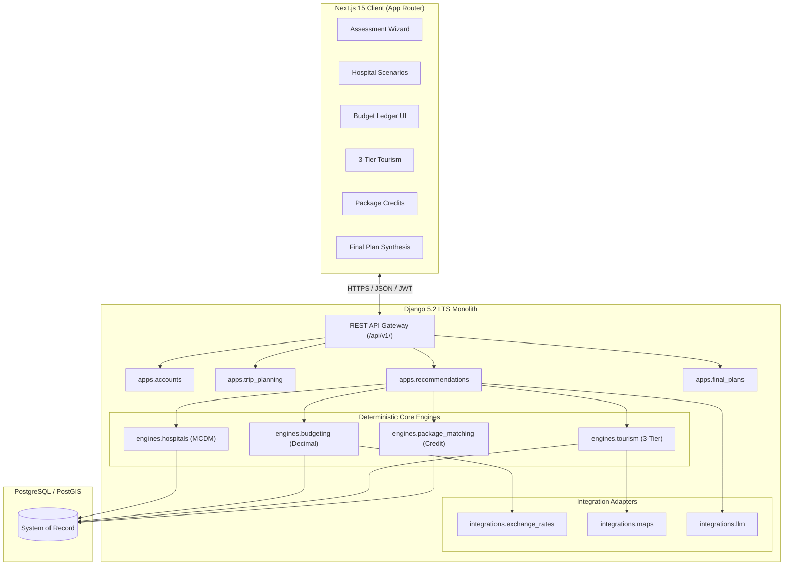

# Architecture Overview — TourPlus AI

## 1. Modular Monolith Architecture

TourPlus AI follows a **modular monolith** pattern with a strict separation between domain data models, deterministic calculation engines, and presentation layers.

## 2. Key Design Decisions

1. **Deterministic Engines**: Financial calculations and recommendation scores are computed using pure mathematical formulas and Python `Decimal` arithmetic.
2. **Hospital-Specific Scenarios**: Because treatment costs, lodging, flights, and travel feasibility vary by hospital and destination city, the system generates separate, parallel scenarios for each eligible hospital.
3. **Double-Counting Prevention**: When travel agencies offer packages that include flights or hotel nights, the system credits those against the mandatory budget ledger, showing the true effective incremental cost.
4. **Data Provenance**: Every entity is explicitly classified as `VERIFIED`, `INDICATIVE`, or `DEMO` to maintain trust with patients.

