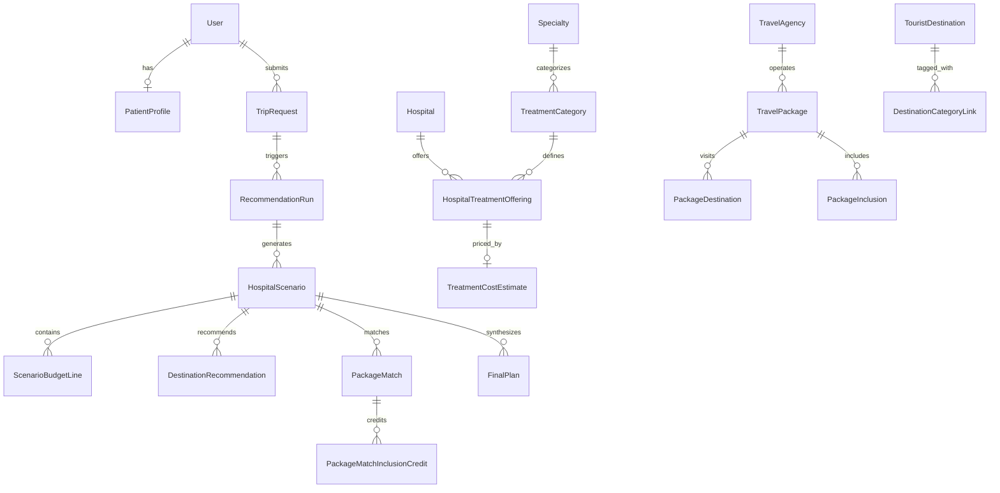

# Database Schema & Entity Relationships — TourPlus AI

## 1. Relational Entity Diagram

## 2. Core Tables Summary

| Table | Domain | Description |
|---|---|---|
| `users` | Accounts | Custom user model with UUID pk, email, and role. |
| `patient_profiles` | Accounts | Patient demographics, residence, emergency contact. |
| `countries`, `states`, `cities` | Geography | Administrative boundaries with lat/long and PostGIS points. |
| `specialties` | Medical | Cardiology, Orthopedics, Oncology. |
| `treatment_categories` | Medical | Specific procedures (e.g. CABG, Knee Replacement). |
| `hospitals` | Hospitals | Verified medical facilities with international support. |
| `hospital_treatment_offerings`| Hospitals | Hospital-procedure junction with availability. |
| `treatment_cost_estimates` | Hospitals | Min, expected, and max procedure costs. |
| `tourist_destinations` | Tourism | Curated attractions with travel intensity and coordinates. |
| `travel_agencies` | Packages | Curated agency operators. |
| `travel_packages` | Packages | Multi-day travel packages with listed pricing. |
| `package_inclusions` | Packages | Equivalent budget category mapping for credits. |
| `trip_requests` | Trip Planning | Patient intake parameters, budget, recovery days. |
| `recommendation_runs` | Recommendations | Immutable snapshot of algorithm run inputs. |
| `hospital_scenarios` | Recommendations | Ranked hospital alternative for a given run. |
| `scenario_budget_lines` | Recommendations | Detailed mandatory expense lines for each scenario. |
| `destination_recommendations` | Recommendations | Recommended attractions across 3 tiers. |
| `package_matches` | Recommendations | Matched agency packages with effective cost. |
| `final_plans` | Final Plans | Saved user itinerary and selected package. |

