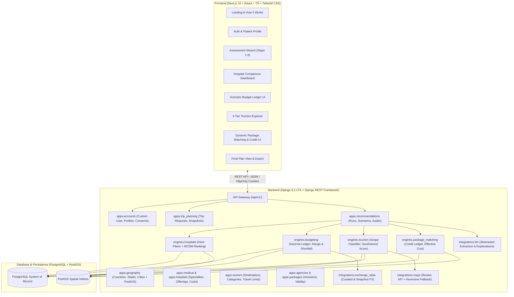
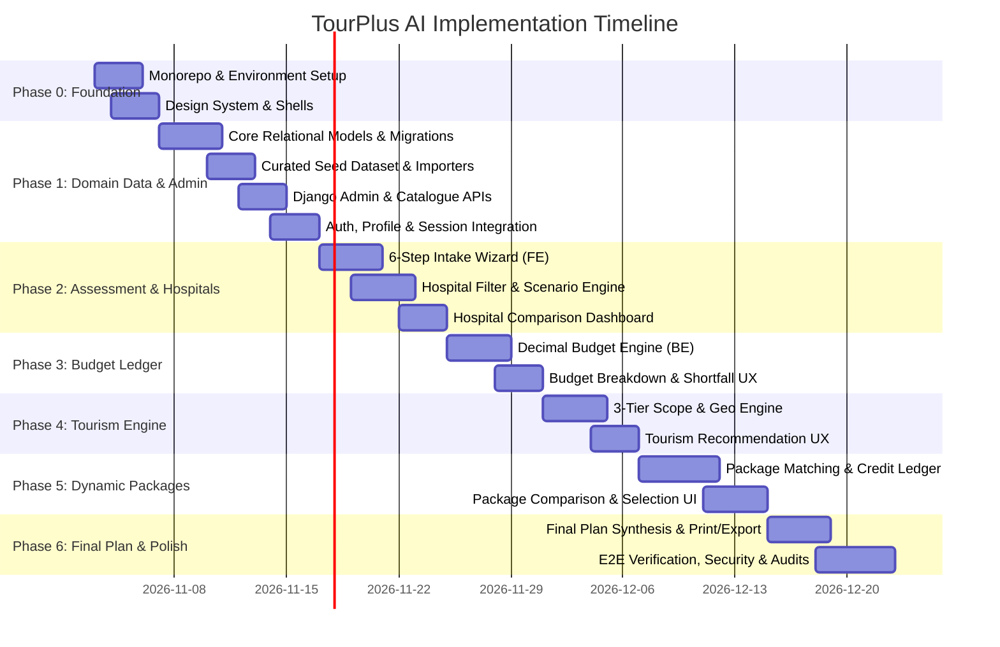

# TourPlus AI — Master Implementation Plan & Phase-by-Phase Task Checklist

> **Product:** TourPlus AI  
> **Source of Truth:** `PRODUCT.md` (v1.0, 2 November 2026)  
> **Document:** `implementation_plan.md`  
> **Status:** Implementation Baseline & Execution Roadmap  
> **Stack:** Next.js App Router (React, TypeScript, Tailwind CSS) + Django 5.2 LTS (DRF, PostgreSQL, PostGIS)  

---

## 1. Executive Summary & Architectural Blueprint

TourPlus AI is an AI-assisted, patient-centric decision-support platform for medical tourism in India. Unlike generic medical directories or travel booking engines, TourPlus AI unifies:
1. **Medical Service Discovery**: Filtering verified offerings across Cardiology, Orthopedics, and Oncology.
2. **Hospital-Specific Financial Planning**: Discrete budget scenarios for each hospital city (treatment, flights, lodging, visas, local transit).
3. **Recovery-Aware Tourism Recommendation**: 3-tier hierarchy (Local/Regional, State-Level, National/Pan-India) strictly governed by recovery constraints and clinician travel guidance.
4. **Dynamic Budget Adjustment & Package Matching**: Curated agency packages matched against recommended destinations, featuring the **Dynamic Package Inclusion Credit** ($EPC_p = P_p - I_p$) to eliminate double-counting of mandatory expenses.
5. **Explainable, Personalized Plan Generation**: End-to-end auditability, reproducible recommendation runs, and provenance tracking (Verified vs. Indicative vs. Demo).



---

## 2. Core Mathematical & Algorithmic Formulations

The implementation must strictly adhere to the deterministic formulas specified in `PRODUCT.md`:

### 2.1 Financial Mathematics (Python `Decimal` Only)
* **Exchange Rate Conversion:**
  $$Amount_s = Amount_c \times FX(c \to s)$$
* **Mandatory Expenditure per Scenario $s$:**
  $$ME_s = TC_s + FC_s + HC_s + VC_s + LC_s + MC_s$$
  Where:
  $$HC_s = \text{NightlyRate} \times \text{Nights} \times \text{Rooms}$$
* **Initial Discretionary Budget:**
  $$DB_{0,s} = B_s - ME_s$$
  * If $DB_{0,s} < 0$: Mark scenario as `OVER_BUDGET`, calculate $\text{Shortfall}_s = |DB_{0,s}|$. Block standard tourism recommendations.
* **Cost Range Handling:**
  $$ME_{min} = \sum C_{i,min}, \quad ME_{expected} = \sum C_{i,expected}, \quad ME_{max} = \sum C_{i,max}$$
  $$DB_{min} = B - ME_{max}, \quad DB_{expected} = B - ME_{expected}, \quad DB_{max} = B - ME_{min}$$
* **Dynamic Package Inclusion Credit:**
  $$\text{Credit}_{p,c} = \min(B_c, V_{p,c}), \quad I_p = \sum_{c} \text{Credit}_{p,c}$$
  * *Rules:* Capped at budgeted amount $B_c$; prorated for nights/party size; zero credit for non-budgeted categories (meals/sightseeing); zero credit for optional extras or unverified values.
* **Effective Incremental Package Cost ($EPC_p$):**
  $$EPC_p = P_p - I_p$$
* **Remaining Budget Balance:**
  $$R_p = DB_{0,s} - EPC_p$$
* **Feasibility Criterion:**
  $$EPC_p \le \text{SpendableBudget}_s = DB_{0,s} - \text{Reserve}_s$$

### 2.2 Recommendation & Ranking Mathematics
* **Hospital Ranking Score ($HScore$):**
  $$HScore = 0.45T + 0.20C + 0.15I + 0.10G + 0.10V$$
  *(Treatment match $T$, Cost suitability $C$, International support $I$, Geography $G$, Verification $V$)*
* **Tourism Destination Preference Score:**
  $$\text{InterestScore}(d) = \frac{\sum_k w_k \cdot \text{Match}(d, k)}{\sum_k w_k}$$
* **Tourism Destination Composite Score ($DScore$):**
  $$DScore(d) = 0.40 I_s + 0.25 G_s + 0.20 C_s + 0.15 V_s$$
* **Tourism 3-Tier Scope Classification:**
  * `LOCAL_REGIONAL`: Within configured local radius / travel time from hospital city.
  * `STATE_LEVEL`: In the same Indian state as hospital city.
  * `NATIONAL`: Other Indian states (only recommended if budget, duration, and recovery permit).
* **Package Destination Coverage:**
  $$\text{Coverage}(p) = \frac{\sum_{d \in D_r \cap D_p} w_d}{\sum_{d \in D_r} w_d}$$
* **Package Ranking Score ($PScore$):**
  $$PScore(p) = 0.45 \text{Coverage}(p) + 0.20 \text{CostEfficiency}(p) + 0.20 \text{ItineraryFit}(p) + 0.10 \text{ServiceCompleteness}(p) + 0.05 \text{AgencyConfidence}(p)$$

---

## 3. Detailed Repository & Monorepo Structure

```text
TourPlus/
├── PRODUCT.md
├── implementation_plan.md
├── README.md
├── CHANGELOG.md
├── .gitignore
├── .editorconfig
├── .env.example
├── docker-compose.yml                 # PostgreSQL 16 + PostGIS 3.4
│
├── docs/                              # Architecture and design records
│   ├── architecture.md
│   ├── database-schema.md
│   ├── api-contracts.md
│   ├── recommendation-methodology.md
│   ├── financial-model.md
│   ├── security-and-privacy.md
│   └── decisions/
│       ├── ADR-001-modular-monolith.md
│       ├── ADR-002-budget-ledger.md
│       └── ADR-003-recommendation-method.md
│
├── backend/                           # Django 5.2 LTS Monolith
│   ├── manage.py
│   ├── requirements/
│   │   ├── base.txt
│   │   ├── dev.txt
│   │   └── prod.txt
│   ├── config/
│   │   ├── __init__.py
│   │   ├── settings/
│   │   │   ├── base.py
│   │   │   ├── development.py
│   │   │   └── production.py
│   │   ├── urls.py
│   │   ├── asgi.py
│   │   └── wsgi.py
│   ├── apps/
│   │   ├── accounts/                  # Custom User (UUID), Profiles, Consents
│   │   ├── geography/                 # Countries, States, Cities (PostGIS)
│   │   ├── medical/                   # Specialties, Treatment Categories
│   │   ├── hospitals/                 # Hospitals, Offerings, Cost Estimates
│   │   ├── tourism/                   # Categories, Destinations, Cost Estimates
│   │   ├── agencies/                  # Travel Agencies
│   │   ├── packages/                  # Travel Packages, Destinations, Inclusions
│   │   ├── trip_planning/             # Trip Requests, Preferences, Consents
│   │   ├── recommendations/           # Runs, Scenarios, Budget Lines, Matches
│   │   ├── final_plans/               # Final Plans, Itineraries, Exports
│   │   └── audit/                     # Audit Events, Configurations
│   ├── engines/
│   │   ├── hospitals/                 # Filtering & MCDM Ranking
│   │   ├── budgeting/                 # Currency & Decimal Ledger
│   │   ├── tourism/                   # Scopes, Distance, Interest Matching
│   │   └── package_matching/          # Coverage, Credit Ledger, Effective Cost
│   ├── integrations/
│   │   ├── llm/                       # Provider adapter (Gemini/OpenAI + Fallback)
│   │   ├── maps/                      # Routes provider + Haversine fallback
│   │   └── exchange_rates/            # Curated / live FX provider
│   ├── common/
│   │   ├── permissions/               # Object-level permissions
│   │   ├── validators/                # Financial and data integrity validators
│   │   ├── exceptions/                # Domain custom exceptions
│   │   └── pagination/                # Standardized REST pagination
│   ├── seed/
│   │   ├── fixtures/                  # Curated JSON seed datasets
│   │   └── importers/                 # Idempotent seed scripts
│   └── tests/
│       ├── unit/                      # Financial & scoring engine unit tests
│       ├── integration/               # Multi-domain scenario tests
│       └── api/                       # DRF endpoint & permission tests
│
├── frontend/                          # Next.js 15 App Router
│   ├── package.json
│   ├── tsconfig.json
│   ├── next.config.ts
│   ├── tailwind.config.ts
│   ├── public/
│   │   ├── logo/
│   │   └── images/
│   └── src/
│       ├── app/
│       │   ├── (public)/              # Landing, How it works, About
│       │   ├── (auth)/                # Login, Register, Forgot Password
│       │   ├── (patient)/             # Dashboard, Profile, Wizard, Scenarios
│       │   │   ├── dashboard/
│       │   │   ├── profile/
│       │   │   ├── plan/new/          # 6-step assessment wizard
│       │   │   ├── plan/[requestId]/  # Review, processing, results
│       │   │   ├── scenario/[scenarioId]/ # Overview, budget, destinations, packages
│       │   │   └── final-plan/[planId]/   # Saved final plan & print view
│       │   ├── layout.tsx
│       │   └── globals.css
│       ├── components/
│       │   ├── ui/                    # Button, Card, Badge, Alert, Modal, Table
│       │   ├── layout/                # Header, Footer, Sidebar, Progress
│       │   └── feedback/              # Skeleton, EmptyState, ErrorBanner
│       ├── features/
│       │   ├── auth/
│       │   ├── trip-assessment/
│       │   ├── hospital-results/
│       │   ├── budget/
│       │   ├── tourism/
│       │   ├── packages/
│       │   └── final-plan/
│       ├── lib/
│       │   ├── api-client.ts          # Typed fetch client with cookie/token handling
│       │   ├── currency.ts            # Formatting & currency helpers
│       │   └── formatters.ts
│       └── types/                     # Shared TypeScript interfaces
│
└── scripts/
    ├── seed_demo_data.py
    └── validate_catalogue.py
```

---

## 4. Phase-by-Phase Implementation Roadmap & Tasks



---

### Phase 0: Project Foundation & Design System Baseline
**Goal:** Establish both frontend and backend project trees, database connectivity, environment configurations, and the shared design tokens.

- [x] **Task 0.1: Monorepo & Environment Initialization**
  - [x] Initialize repository structure with `.gitignore`, `.editorconfig`, `.env.example`.
  - [x] Create `docker-compose.yml` for local development PostgreSQL 16 + PostGIS 3.4.
  - [x] Create `docs/` folder with architectural decision records (ADRs).
- [x] **Task 0.2: Backend Initialization (Django 5.2 LTS + DRF)**
  - [x] Initialize Django project in `backend/` with modular settings (`base.py`, `development.py`, `production.py`).
  - [x] Configure `requirements/base.txt`, `dev.txt`, `prod.txt` (Django, djangorestframework, psycopg2-binary/psycopg, django-cors-headers, postgis packages).
  - [x] Create `apps.accounts` app with Custom User model (`id = UUIDField`, `email` unique login, roles: `PATIENT`, `ADMIN`, `DATA_CURATOR`).
  - [x] Run initial migrations to establish custom user model before any other tables.
  - [x] Implement system health-check endpoint (`GET /api/v1/health/`) returning DB and system status.
- [x] **Task 0.3: Frontend Initialization (Next.js 15 App Router + TypeScript + Tailwind CSS)**
  - [x] Create Next.js app in `frontend/` using TypeScript, Tailwind CSS, App Router.
  - [x] Configure Tailwind CSS color tokens matching Section 8.1:
    - Primary (`#103044`), Blue (`#1B74A8`), Green (`#259970`), Cyan (`#2DA6C9`), Surface (`#F4F7F9`), Mint (`#E4F6EF`), Light Blue (`#E6F4FA`), Danger (`#B94A48`), Warning (`#A66B16`).
  - [x] Configure typography (Montserrat for headings, Inter/Poppins for body).
  - [x] Build core UI component primitives in `frontend/src/components/ui/`: `Button`, `Card`, `Badge`, `Alert`, `Input`, `Select`, `Modal`, `Table`, `Tabs`.
  - [x] Build application layout shell: Navigation bar, Footer, Safety/Medical Disclaimers.
  - [x] Implement responsive Public Landing Page (`/`), How it Works (`/how-it-works`), and About (`/about`).
- [x] **Task 0.4: API Client & Integration Setup**
  - [x] Create centralized typed `api-client.ts` supporting base URL, error parsing, timeout, and authentication cookies/tokens.
  - [x] Verify local end-to-end communication between Next.js frontend and Django backend.

---

### Phase 1: Domain Data Architecture, Admin Curation & Catalogue APIs
**Goal:** Implement all persistent catalogue models, data provenance, Django Admin management, idempotent seeding for the 3 target specialties, and catalogue browsing.

- [x] **Task 1.1: Geography & Provenance Models (`apps.geography`, `apps.provenance`)**
  - [x] `countries` (id, name, iso2, iso3, default_currency, is_active).
  - [x] `states` (id, country_id, name, code).
  - [x] `cities` (id, state_id, name, latitude, longitude, location PostGIS point, is_active).
  - [x] `data_sources` (id, source_name, publisher, source_url, source_type, reliability_level, accessed_at).
  - [x] `exchange_rates` (id, base_currency, quote_currency, rate, effective_at, provider_name).
- [x] **Task 1.2: Medical & Hospital Models (`apps.medical`, `apps.hospitals`)**
  - [x] `specialties` (id, name, slug, description, is_active) -> Seeds: Cardiology, Orthopedics, Oncology.
  - [x] `treatment_categories` (id, specialty_id, name, slug, description, is_active, review_status).
  - [x] `hospitals` (id, name, slug, description, city_id, address, postal_code, latitude, longitude, location, website_url, international_patient_support, international_patient_details, verification_status, data_classification, source_id, last_verified_at, is_published).
  - [x] `hospital_specialties` (hospital_id, specialty_id, verification_status, source_id).
  - [x] `hospital_treatment_offerings` (hospital_id, treatment_category_id, offering_description, availability_status, verification_status, source_id, last_verified_at).
  - [x] `treatment_cost_estimates` (hospital_treatment_offering_id, min_amount, expected_amount, max_amount, currency, price_basis, included_services, excluded_services, valid_from, valid_until, data_classification).
- [x] **Task 1.3: Tourism Models (`apps.tourism`)**
  - [x] `destination_categories` (Heritage/History, Nature, Wildlife, Culture, Museums, Beaches, Spiritual, Modern, Food, Nightlife).
  - [x] `tourist_destinations` (id, name, slug, description, city_id, latitude, longitude, location, suggested_visit_duration_minutes, travel_intensity, accessibility_notes, opening_information, entry_fee_min/expected/max, currency, verification_status, data_classification, source_id, last_verified_at, is_published).
  - [x] `destination_category_links` (destination_id, category_id).
  - [x] `destination_cost_estimates` (destination_id, cost_type, min/expected/max amount, currency, party_basis).
- [x] **Task 1.4: Agency & Package Models (`apps.agencies`, `apps.packages`)**
  - [x] `travel_agencies` (id, name, slug, website_url, contact_email, headquarters_city_id, verification_status, data_classification, source_id, is_published).
  - [x] `travel_packages` (id, agency_id, name, description, package_type: LOCAL/STATE/NATIONAL/CUSTOM, duration_days, price_amount, currency, price_basis: PER_PERSON/PER_GROUP, min/max group size, valid_from/until, availability_status, verification_status, data_classification, is_published).
  - [x] `package_destinations` (package_id, destination_id, sequence_order, planned_visit_duration, overnight_stay).
  - [x] `package_inclusions` (package_id, inclusion_type, inclusion_status: INCLUDED/OPTIONAL_EXTRA/NOT_INCLUDED, description, quantity, unit, service_value_amount, service_value_currency, equivalent_budget_category: INTERNATIONAL_FLIGHT/ACCOMMODATION/LOCAL_TRANSPORT/VISA/MISCELLANEOUS).
- [x] **Task 1.5: Idempotent Seed Data Importers (`backend/seed/`)**
  - [x] Prepare curated datasets matching targets: 20-30 hospitals across 8-12 cities, 60-100 tourist destinations, 5-10 agencies, 10-20 packages.
  - [x] Build CLI script `python manage.py seed_catalogue` with strict idempotency (upsert by slug/natural key).
  - [x] Explicitly tag all records with data classification (`VERIFIED`, `INDICATIVE`, or `DEMO`).
- [x] **Task 1.6: Django Admin Dashboard**
  - [x] Register all catalogue models in Django Admin with customized list views, filters by verification status, search fields, and inline relationships.
  - [x] Add validation in Admin to prevent publishing records with unverified or missing required data.
- [x] **Task 1.7: Public Catalogue API Endpoints (`/api/v1/catalog/`, `/api/v1/hospitals/`, `/api/v1/destinations/`)**
  - [x] Implement read-only DRF ViewSets exposing published specialties, treatment categories, cities, hospitals, and destinations.
  - [x] Exclude sensitive internal data, non-published items, and unapproved records.
- [x] **Task 1.8: Authentication, Profile & Consent Implementation**
  - [x] Implement endpoints: `/auth/register/`, `/auth/login/`, `/auth/logout/`, `/auth/me/`, `/auth/forgot-password/`.
  - [x] Build Frontend Auth pages: Login, Register, Profile, Consent modal.

---

### Phase 2: Patient Assessment Wizard & Hospital Scenarios
**Goal:** Build the guided 6-step intake wizard with draft persistence, implement hospital filtering and ranking algorithms, and create independent hospital scenarios.

- [x] **Task 2.1: Trip Planning Domain Models (`apps.trip_planning`, `apps.recommendations`)**
  - [x] `trip_requests` (id, user_id, origin_country_id, specialty_id, treatment_category_id, known_condition_text, total_budget_amount, budget_currency, party_size, preferred_arrival_date, preferred_departure_date, available_days, recovery_duration_days, clinician_travel_guidance_status, clinician_restrictions, insurance_status, travel_intensity_preference, status: DRAFT/SUBMITTED/PROCESSING/COMPLETED/FAILED).
  - [x] `trip_request_interests` (trip_request_id, destination_category_id, preference_weight: 1-5).
  - [x] `recommendation_runs` (id, trip_request_id, run_number, status, algorithm_version, weight_configuration_snapshot, input_snapshot, started_at, completed_at, error_message).
  - [x] `hospital_scenarios` (id, recommendation_run_id, hospital_treatment_offering_id, rank, eligibility_status, exclusion_reason, ranking_score, scenario_currency).
- [x] **Task 2.2: Multi-Step Assessment Wizard UI (`/plan/new`)**
  - [x] **Step 1: Origin & Travel Details** (Country, party size, display currency, tentative dates/duration).
  - [x] **Step 2: Medical Requirement** (Specialty selection: Cardiology/Orthopedics/Oncology, treatment category dropdown, free-text condition/doctor notes).
  - [x] **Step 3: Recovery & Travel Constraints** (Recovery days, clinician travel guidance status: PROVIDED / NOT_PROVIDED, mobility limits, intensity).
  - [x] **Step 4: Financial Information** (Total available budget, currency, budget scope: solo vs travel party, contingency reserve preference).
  - [x] **Step 5: Tourism Preferences** (Multi-select interest categories with weight sliders 1-5, preferred accommodation tier).
  - [x] **Step 6: Review & Consent** (Structured summary, explicit consent check, disclaimer acknowledgment).
  - [x] Implement auto-save draft functionality (`PATCH /api/v1/trip-requests/{id}/`).
- [x] **Task 2.3: Hospital Eligibility & Ranking Engine (`engines/hospitals/`)**
  - [x] Hard eligibility filtering: active hospital, matching verified specialty & treatment category offering, valid location data, published status.
  - [x] Record exclusion reasons for non-matching hospitals.
  - [x] Multi-criteria soft ranking score ($HScore = 0.45T + 0.20C + 0.15I + 0.10G + 0.10V$).
  - [x] Unit tests for eligibility and ranking logic.
- [x] **Task 2.4: Recommendation Run Orchestration (`/trip-requests/{id}/generate-plan/`)**
  - [x] Validates request inputs and consent.
  - [x] Creates immutable `RecommendationRun` record with input snapshot.
  - [x] Generates separate `HospitalScenario` records for every eligible hospital.
  - [x] Handles synchronous/asynchronous execution state (`PROCESSING` -> `COMPLETED`).
- [x] **Task 2.5: Hospital Scenario Comparison UI (`/plan/[requestId]/results`)**
  - [x] Comparison layout (table on desktop, stacked cards on mobile).
  - [x] Display hospital name, city, specialty match, indicative treatment cost range, verification status, and scenario action button.
  - [x] Explain ranking factors and show clear medical disclaimers ("Matched Hospital", never "Medically Best").

---

### Phase 3: Hospital-Specific Budget Engine & Financial Scenarios
**Goal:** Implement the deterministic Decimal-based budget ledger, calculating mandatory expenditures, cost ranges, shortfall states, and remaining discretionary budgets for each hospital scenario.

- [x] **Task 3.1: Scenario Budget Ledger Models (`apps.recommendations`)**
  - [x] `scenario_budget_lines` (id, hospital_scenario_id, expense_category: TREATMENT / INTERNATIONAL_FLIGHT / ACCOMMODATION / VISA / LOCAL_TRANSPORT / MISCELLANEOUS, description, min_amount, expected_amount, max_amount, source_currency, scenario_currency, exchange_rate_snapshot, converted_expected_amount, quantity, unit, data_classification).
- [x] **Task 3.2: Budget Calculation Engine (`engines/budgeting/`)**
  - [x] Convert all amounts using recorded exchange rate snapshot (`FX(c -> s)`).
  - [x] Calculate mandatory expenditures ($ME_s = TC_s + FC_s + HC_s + VC_s + LC_s + MC_s$).
  - [x] Quantity-based accommodation calculation ($HC_s = \text{NightlyRate} \times \text{Nights} \times \text{Rooms}$).
  - [x] Calculate initial discretionary budget ($DB_{0,s} = B_s - ME_s$).
  - [x] Detect `OVER_BUDGET` status when $DB_{0,s} < 0$, calculating shortfall ($|\text{DB}_{0,s}|$).
  - [x] Calculate parallel min/expected/max budget ranges: $DB_{min} = B - ME_{max}$, $DB_{max} = B - ME_{min}$.
  - [x] Apply configurable contingency reserve ($SpendableBudget_s = DB_{0,s} - Reserve_s$).
- [x] **Task 3.3: Budget Engine Unit & Edge Case Tests**
  - [x] Test exact Decimal precision (no floating-point rounding errors).
  - [x] Test negative discretionary budget handling.
  - [x] Test missing currency exchange rate handling.
  - [x] Test multi-party flight and room multiplier calculations.
- [x] **Task 3.4: Budget Dashboard UI (`/scenario/[scenarioId]/budget`)**
  - [x] Visual breakdown of mandatory expenses vs. initial discretionary budget.
  - [x] Stacked cost distribution chart with verified reconciliation to line items.
  - [x] Clear labeling of Indicative vs. Verified costs.
  - [x] Distinct warning alert and shortfall explanation for over-budget scenarios.

---

### Phase 4: Recovery-Aware 3-Tier Tourism Engine
**Goal:** Recommend feasible tourist destinations across Local/Regional, State-Level, and National scopes, constrained by post-treatment recovery and clinician guidance.

- [x] **Task 4.1: Tourism Recommendation Models (`apps.recommendations`)**
  - [x] `destination_recommendations` (id, hospital_scenario_id, destination_id, tourism_scope: LOCAL_REGIONAL / STATE_LEVEL / NATIONAL, rank, interest_score, geography_score, cost_score, data_confidence_score, recovery_review_status, estimated_visit_cost, estimated_route_cost, estimated_route_duration, feasibility_status, explanation).
- [x] **Task 4.2: Route & Maps Integration Adapter (`integrations/maps/`)**
  - [x] Create `MapsProvider` interface with concrete implementations:
    - Provider 1: Google Maps Routes API (when API key is present).
    - Provider 2: PostGIS / Haversine distance-based fallback with estimated average speed.
  - [x] Cache route results to minimize external calls.
- [x] **Task 4.3: Tourism Recommendation Engine (`engines/tourism/`)**
  - [x] Hard constraints filter: Active destinations, route availability, schedule window check, recovery constraint compliance.
  - [x] 3-Tier Scope classification relative to hospital city:
    - `LOCAL_REGIONAL`: Within configurable radius / transit duration.
    - `STATE_LEVEL`: In hospital's state.
    - `NATIONAL`: Pan-India destinations.
  - [x] Soft ranking:
    - $\text{InterestScore}(d)$ via weighted category match.
    - $\text{GeoScore}(d)$ based on travel time.
    - $\text{CostScore}(d)$ based on visit cost vs. discretionary budget.
    - Composite $DScore(d) = 0.40 I_s + 0.25 G_s + 0.20 C_s + 0.15 V_s$.
  - [x] Enforce recovery constraint boundary: flag unconfirmed activities for clinician review.
- [x] **Task 4.4: Tourism Recommendation UI (`/scenario/[scenarioId]/destinations`)**
  - [x] Segmented scope tabs (`Local / Regional`, `State-Level`, `National / Pan-India`).
  - [x] Destination cards showing travel intensity, travel duration from hospital, entry fees, suggested visit duration, and match reasons.
  - [x] Clinician review badges on destinations requiring medical clearance.

---

### Phase 5: Dynamic Travel-Agency Package Matching & Inclusion Credit Ledger
**Goal:** Match curated travel-agency packages with recommended destinations, applying the Dynamic Inclusion Credit to eliminate double-counting and derive effective incremental costs.

- [x] **Task 5.1: Package Match & Credit Ledger Models (`apps.recommendations`)**
  - [x] `package_matches` (id, hospital_scenario_id, travel_package_id, rank, destination_coverage_score, inclusion_credit, listed_package_price, effective_incremental_cost, remaining_discretionary_budget, budget_feasibility_status, itinerary_fit_score, agency_reliability_score, overall_score, explanation).
  - [x] `package_match_inclusion_credits` (id, package_match_id, package_inclusion_id, scenario_budget_line_id, credited_amount, credited_currency, credit_reason).
- [x] **Task 5.2: Package Matching & Credit Engine (`engines/package_matching/`)**
  - [x] Calculate destination coverage:
    $$\text{Coverage}(p) = \frac{\sum_{d \in D_r \cap D_p} w_d}{\sum_{d \in D_r} w_d}$$
  - [x] Credit calculation: Match package inclusions against mandatory scenario budget lines (`equivalent_budget_category`).
    $$\text{Credit}_{p,c} = \min(B_c, V_{p,c})$$
  - [x] Enforce double-counting prevention: Cap credit at budgeted expense; prorate hotel nights; exclude unbudgeted services (sightseeing/meals); ignore unverified or optional values.
  - [x] Calculate effective incremental package cost:
    $$EPC_p = P_p - I_p$$
  - [x] Calculate remaining discretionary budget:
    $$R_p = DB_{0,s} - EPC_p$$
  - [x] Enforce budget feasibility check: $EPC_p \le SpendableBudget_s$.
  - [x] Composite package ranking:
    $$PScore(p) = 0.45\text{Coverage} + 0.20\text{CostEff} + 0.20\text{ItineraryFit} + 0.10\text{ServiceComp} + 0.05\text{AgencyConf}$$
- [x] **Task 5.3: Package Matching Unit & Financial Tests**
  - [x] Test flight credit when package includes international airfare vs. when it does not.
  - [x] Test partial hotel night crediting (e.g. 3 of 7 nights credited).
  - [x] Test that sightseeing/meals do not receive mandatory credit.
  - [x] Test party size price normalization.
  - [x] Test duplicate credit prevention on multiple runs.
- [x] **Task 5.4: Package Comparison UI (`/scenario/[scenarioId]/packages`)**
  - [x] Side-by-side package cards comparing: Listed Package Price, Included Service Credit, Effective Incremental Cost, and Remaining Discretionary Budget.
  - [x] Interactive breakdown modal explaining how each credit was derived.
  - [x] Clear call to action to select a package for the final plan.

---

### Phase 6: Final Plan Synthesis, Export, Hardening & Staging Release
**Goal:** Allow the patient to save, customize, and export their comprehensive medical-tourism plan; implement audit logging, security hardening, and complete end-to-end integration testing.

- [x] **Task 6.1: Final Plan Models (`apps.final_plans`)**
  - [x] `final_plans` (id, user_id, hospital_scenario_id, package_match_id nullable, selected_scope, status, plan_title, created_at, updated_at).
  - [x] `final_plan_destinations` (final_plan_id, destination_id, sequence_order, planned_visit_date, planned_duration_minutes, notes).
- [x] **Task 6.2: Final Plan Management API & Endpoints**
  - [x] `POST /api/v1/final-plans/`: Save selected hospital, optional package, and ordered destinations.
  - [x] `GET /api/v1/final-plans/{id}/`: Retrieve saved plan.
  - [x] `GET /api/v1/final-plans/{id}/export/`: Render printable HTML/JSON export summary.
- [x] **Task 6.3: Final Plan UI & Print/Export Layout (`/final-plan/[planId]`)**
  - [x] Unified summary view: Hospital details, medical offering, complete budget breakdown, tourism itinerary, package details, and remaining balance.
  - [x] Print-optimized stylesheet (`@media print`) for clean offline printing.
  - [x] Prominent Medical & Financial Safety Disclaimers.
- [x] **Task 6.4: AI/LLM Provider Integration (`integrations/llm/`)**
  - [x] Implement `LLMProvider` abstraction (Google Gemini API / OpenAI).
  - [x] Structured extraction of user requirements from free-text doctor notes.
  - [x] Natural language explanations of hospital matches and package trade-offs.
  - [x] Graceful fallback: If LLM is offline or disabled, fallback to deterministic template explanations with zero disruption to planning.
- [x] **Task 6.5: Audit Logging & History Dashboard**
  - [x] Capture administrative edits and recommendation executions in `audit_events`.
  - [x] Patient Dashboard (`/dashboard`) displaying draft requests, past recommendation runs, and saved final plans.
- [x] **Task 6.6: Security Hardening & Permission Auditing**
  - [x] Enforce strict DRF object-level permissions (Patient A cannot access Patient B's requests, scenarios, or plans).
  - [x] Sanitize all free-text fields; prevent XSS, CSRF, and injection attacks.
  - [x] Verify that no API keys or credentials exist in client bundles.
- [x] **Task 6.7: Comprehensive End-to-End Verification Test**
  - [x] Execute automated full user journey:
    `Register -> Login -> Complete Wizard (Cardiology) -> Generate Scenarios -> View Hospital Comparison -> Inspect Budget Breakdown -> Explore Destinations -> Match Package with Credit -> Save Final Plan -> Verify Persistence & Totals`.

---

## 5. Verification & Acceptance Criteria Matrix

| Milestone | Deliverables | Verification Gateway & DoD |
|---|---|---|
| **Phase 0** | Monorepo, Next.js shell, Tailwind tokens, Django setup, Custom User, Health API | `GET /api/v1/health/` returns 200 OK; Next.js landing page renders with Clinical Blue/India Green theme; Docker PostgreSQL/PostGIS running. |
| **Phase 1** | Geography, Medical, Tourism, Package models; Idempotent Seed data; Django Admin; Auth | `python manage.py seed_catalogue` populates target records; Django admin allows CRUD; Catalogue APIs respond with published data only; Auth flow works. |
| **Phase 2** | 6-Step Wizard, Hospital filter & MCDM ranking, Scenario creation | User can submit request; System filters hospitals by specialty; Independent scenarios created in DB; Hospital cards render with verification badges. |
| **Phase 3** | Decimal Budget Ledger, Multi-currency FX, Range & Shortfall calculation | Budget reconciles to exact cent ($\sum \text{Lines} = \text{ME}_s$); Over-budget scenarios show shortfall; Zero float precision bugs; Tests pass. |
| **Phase 4** | 3-Tier Tourism Classifier, Geo/Route engine, Recovery constraint filter | Scopes (Local, State, National) correctly categorized; Route calculation fallback functions; Destinations flagged if clinician guidance is missing. |
| **Phase 5** | Package coverage matching, Inclusion Credit Ledger, $EPC_p$ calculation | Double-counting prevented; Credit ledger accurately links inclusions to budget lines; $EPC_p$ and remaining budget calculate accurately; Tests pass. |
| **Phase 6** | Final Plan saving, Print/Export layout, LLM fallback, History, Security check | Complete end-to-end user journey succeeds; Print view clean; Patient data strictly isolated; Disclaimers clearly visible. |

